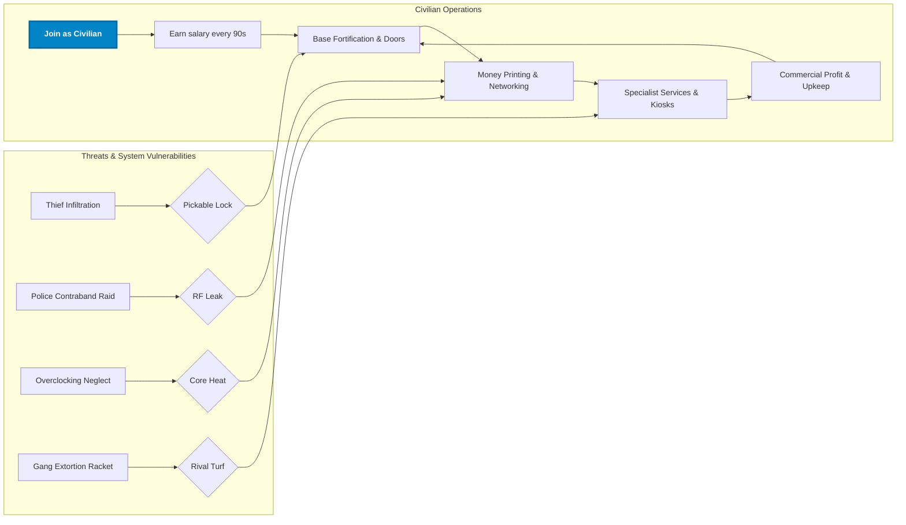
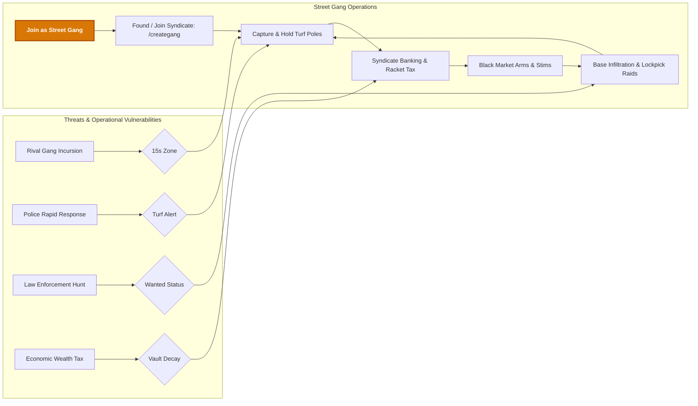
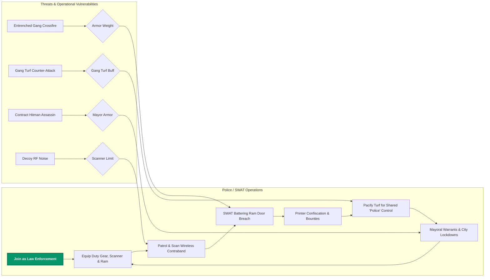
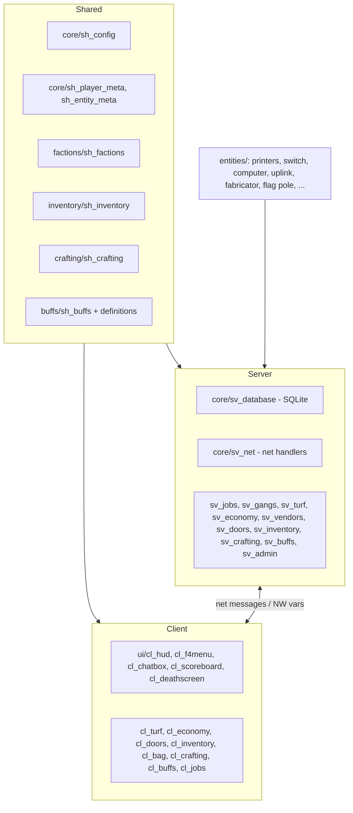
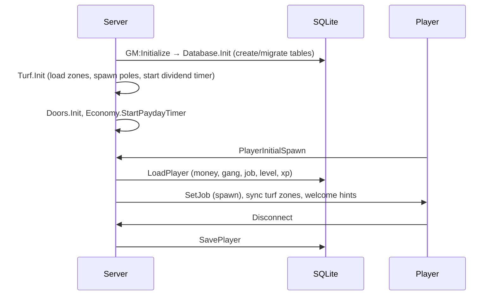
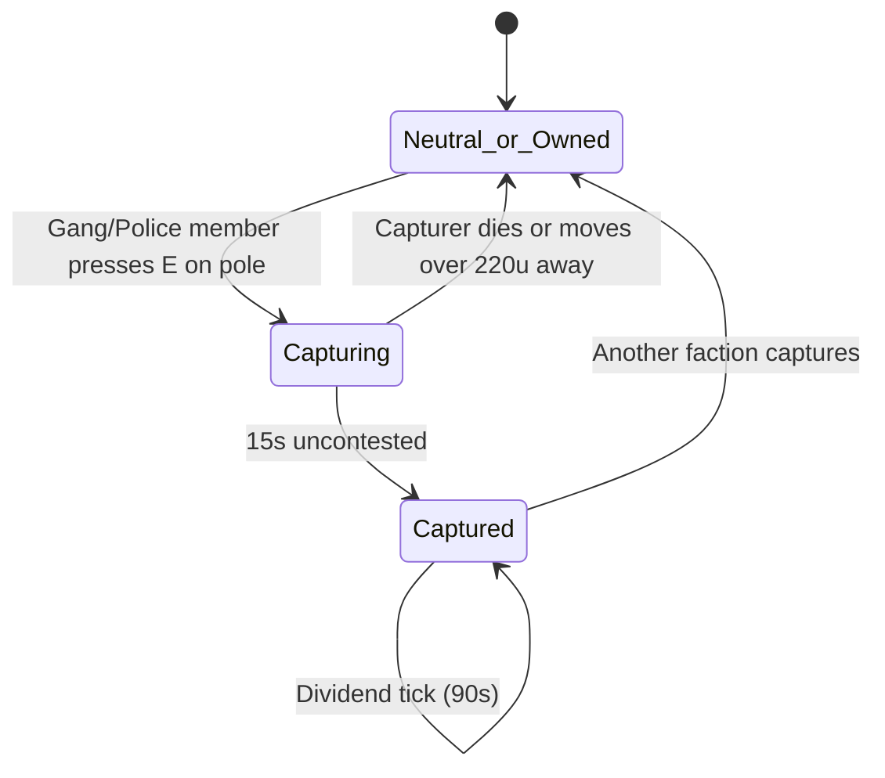

# GangWars RP (GWRP)

**Version:** 2.0.0 (2026) · **Author:** Toxic · **Base gamemode:** `sandbox` · **Maps:** `^rp_*`

GangWars RP is a Garry's Mod roleplay gamemode built around three competing groups: **Citizens** (and specialist service jobs), **Street Gangs** and **Police/SWAT**. Players earn money from salaries, money printers, crafting and territory, then spend it on gear, doors, networking hardware and weapons. Gangs fight over **turf**, police raid **contraband printers**, and Cyber Engineers **hack** networks.

---

## Table of Contents
1. [Features](#features)
2. [Requirements & Installation](#requirements--installation)
3. [Quick Start](#quick-start)
4. [Concept of Operations](#concept-of-operations)
5. [How It Operates (Technical)](#how-it-operates-technical)
6. [Configuration](#configuration)
7. [Commands](#commands)
8. [Jobs Reference](#jobs-reference)
9. [Shop Reference](#shop-reference)
10. [Extending the Gamemode](#extending-the-gamemode)
11. [Project Structure](#project-structure)
12. [Credits & License](#credits--license)

---

## Features

- **15 jobs across 3 factions**, with level gates, specialized equipment, and per-job slot limits.
- **Player-run gangs** with MariaDB-backed rosters, ranks, invites and private gang chat.
- **Turf warfare**: flag poles with timed captures and periodic dividends, per-map zone profiles and an admin setup tool.
- **Economy**: salary paydays, dropped cash, an F4 shop with job/level restrictions and retail markups, and purchasable doors.
- **Money printers** with a heat model, a venting timing minigame, hardware modules (undervolt / overclock) and police confiscation.
- **Networking gameplay**: L3 switches, copper/fiber cables, WAN uplinks, and efficiency that scales with network topology.
- **Cyber layer**: an in-game computer terminal (nmap, ping, airmon, WAN cracking, Metasploit-style exploits) and the CyberDeck phone.
- **Crafting**: Resource Fabricators produce ingots, carbon rods and weapon blueprints, which are crafted into weapons, bags and gear.
- **Inventory**: a 16-slot backpack plus four equippable bags, with quality tiers.
- **Buff/debuff engine**: persistent, stackable effects (healing, speed, wanted, poison and more).
- **Leveling**: levels 1–50 on an MMO-style XP curve.
- **Persistence**: Production MariaDB (via mysqloo v9) with 100% Stored Procedures for writes, Analytical Views for reads, in-memory RAM caching, range-partitioned telemetry, and automatic SQLite development fallback.
- **Optional Wiremod** outputs on printers, switches and computers.

---

## Requirements & Installation

**Requirements**
- A Garry's Mod dedicated server (or listen server).
- An `rp_` map. A default turf template ships for `rp_downtown_v4c_v2`.
- *Optional:* Wiremod (enables wire outputs and inputs on entities).

**Install**
1. Copy this folder to `garrysmod/gamemodes/gangwarsrp/`. The folder name must match [gangwarsrp.txt](gangwarsrp.txt).
2. Start the server with:
   ```
   +gamemode gangwarsrp +map rp_downtown_v4c_v2
   ```
3. Import the MariaDB schema from `sql/gw_mariadb_schema.sql` into your database (`mysql -u root -p gw < sql/gw_mariadb_schema.sql`).
   Configure database credentials in `garrysmod/data/gw/database.json` or startup ConVars (`+gw_db_host 127.0.0.1 +gw_db_user root +gw_db_password secret +gw_db_database gw`).
   If running locally without the `mysqloo` binary module, the gamemode will automatically fallback to SQLite emulation for development.
4. Grant yourself admin (`admin` or `superadmin` user group) to use setup tools.

> Entities and weapons live in `entities/` inside the gamemode folder and are loaded with the gamemode.

---

## Quick Start

1. Join the server. You spawn as a **Citizen** with **$250**.
2. Press **F4** for the Store & Jobs menu. Press **F2** for the door/property menu.
3. You earn your job's salary every **90 seconds**.
4. Buy a **Money Printer**, plus a **Copper Wiring Tool** and **L3 Network Switch** to network several printers for higher efficiency.
5. Create a gang with `/creategang <name>` ($200), or go police, and capture **flag poles** for dividends.
6. Level up from kills, turf captures and printer collection to unlock better jobs and gear.

---

## Concept of Operations

### Faction Viewpoints & Philosophies

The metropolis is driven by a tri-faction power dynamic where commerce, violent underworld syndication, and state enforcement constantly clash. Every economic venture generates exposure, and every faction capability introduces tactical counter-play.

#### 1. Civilian Faction (Commerce, Enterprise & Specialist Services)
- **Core Philosophy:** Economic self-determination, capital accumulation, and free-market opportunism. Civilians thrive by constructing secure bases, engineering multi-printer networks, and vending essential goods and services.
- **Key Objectives:** Build fortified compounds with keypad doors, maximize money printer networking efficiency (up to 100%), deploy automated Clinic Pods and Gun Kiosks, and reinvest revenue into property upkeep and advanced hardware.
- **Faction Interactions:**
  - *Vs. Gangs:* Gangs view civilians as primary targets for burglary, extortion, and protection racket taxes (5%–30%). Civilians must hire private security or arm themselves, though they may quietly purchase black-market hardware.
  - *Vs. Police:* Police provide protection from street violence, but aggressively search and seize unregistered money printers (+50% bounty to patrol officers).

#### 2. Street Gangs Faction (Territory, Extortion & Syndication)
- **Core Philosophy:** Collective dominance, territorial sovereignty, and predatory extraction. Street gangs reject state authority, leveraging armed syndicates to seize public turf, extort local commerce, and traffic illegal contraband.
- **Key Objectives:** Form player syndicates (`/creategang`), conquer and defend map flag poles for passive dividends, levy protection taxes (`/settax 5-30`), crack civilian vaults with tactical lockpicks, and execute contract hits.
- **Faction Interactions:**
  - *Vs. Civilians:* Civilians are revenue sources to be shaken down for protection taxes, raided for printer loot, or serviced with illicit weapons and stims.
  - *Vs. Police:* Police are direct operational adversaries. Gangs gain a **Turf Defender Bonus** (+$100 and +100 XP per officer slain on claimed territory). However, criminal acts inflict persistent *Wanted* status that survives death and disconnects.

#### 3. Police / SWAT Faction (Order, Interdiction & Civil Protection)
- **Core Philosophy:** Urban pacification, contraband interdiction, and strict civil defense. Law enforcement maintains city stability by breaking organized crime syndicates, neutralizing illegal money print farms, and upholding the Mayor's authority.
- **Key Objectives:** Patrol urban sectors with wireless Contraband Scanners, execute dynamic tactical breaches using the SWAT Battering Ram, neutralize illegal printers for cash bounties, capture territory under the unified `"Police"` claimant, and enforce citywide lockdowns.
- **Faction Interactions:**
  - *Vs. Civilians:* Civilians are citizens under state protection, yet are subject to scanning, warrantless perimeter checks, and property raids if contraband signals are detected.
  - *Vs. Gangs:* Gangs are armed combatants to be neutralized, disarmed, and pushed out of occupied urban territories.

---

### Core Gameplay Loops & Threat Models

#### Civilian Faction Capability & Threat Model


#### Street Gangs Faction Capability & Threat Model


#### Police / SWAT Faction Capability & Threat Model


### Risk / Reward Summary
- **Printers:** High financial yield at max efficiency (up to 100%), but heat generates explosion risks if unvented, and radio emissions invite police raids.
- **Networking:** L3 switches and cables elevate printer output from 60% up to 100%, but cables snap if extended beyond 550 units (800 for fiber) and expose the network to remote sniffing.
- **Police Interdiction:** Officers earn direct cash bounties (+50% for Patrol Officers) for confiscating illegal printers and pacifying territory.
- **Turf Conquest:** Holding a flag pole yields passive syndicate dividends every 90s, but requires surviving within 450 units of the pole for 15s under public broadcast.
- **Death & Bounties:** Dying drops 10% of carried wallet cash (capped at $75). *Wanted* status is permanent across deaths and disconnects until served or cleared.

---

## How It Operates (Technical)

### Architecture



`gamemode/init.lua` registers all client/shared files with `AddCSLuaFile` and includes server modules. `gamemode/shared.lua` derives from `sandbox` and loads the shared modules.

### Boot sequence



On shutdown, every player plus the turf map profile is committed.

### Runtime loops

| Loop | Interval | Effect |
|---|---|---|
| Payday | 90 s | Each player receives their job salary. |
| Turf dividends | 90 s | Online members of an owning gang (or Police) receive $25 per owned turf and 25 XP. |
| Printer cycle | 20 s per printer | Adds `PrintAmount × efficiency` to stored cash and raises temperature. |
| Buff ticks | per buff | HoT, poison and so on, persisted so offline time is handled correctly (`tickOffline`). |

### State and networking
- Player state (money, job, gang, level, XP) is held in **networked vars** (`GW_Money`, `GW_Job`, `GW_Gang`, `GW_Level`, `GW_XP`) and saved to SQLite.
- Client actions (buy, change job, door actions, admin actions) use **net messages** with **per-action rate limiting** (`GW.CheckRateLimit`) and server-side validation (level, job, distance, affordability).
- Admin net actions require `IsAdmin()`/`IsSuperAdmin()`.

### Persistence

[core/sv_database.lua](gamemode/core/sv_database.lua) provides:
- `?`-placeholder **prepared statements** with sanitization, plus a **catalog of named procedures** (`GW.Database.Call("GET_PLAYER", {steamid})`).
- **Nested transactions** (`WithTransaction`) with automatic rollback.
- **Migrations** for added columns.

| Table | Purpose |
|---|---|
| `gw_players` | money, respect, gang, job, level, xp, last_seen |
| `gw_gangs` / `gw_gang_members` | gang registry, bank, leader, member ranks |
| `gw_inventory` / `gw_player_bags` | slot-grid items and equipped bags |
| `gw_turfs` | per-map turf zones and owners |
| `gw_player_buffs` | persistent buffs and debuffs |
| `gw_settings` | key/value settings |

Turf zones are also exported to `data/gangwarsrp/maps/<map>.json` as a backup. Load order is **SQLite → JSON → built-in template**.

### Turf capture flow



A capture pays the capturer **$40 + 150 XP** and announces the result server-wide. Citizens cannot capture. Gang members need a gang first.

### Printer & network efficiency model
- Base yield (per 20 s cycle): **Bronze 4 · Silver 10 · Diamond 25**, multiplied by efficiency.
- Efficiency: **60%** standalone, **80%** with 2 printers on a switch, **100%** with 3 or more. This works out to about **$12 / $30 / $75 per minute** at 100%.
- **Overclock**: +50% yield, +3 heat per cycle. **Undervolt**: heat per cycle 4 → 1. **Cyber-Tuned** (Cyber Engineer with the Cryo Calibrator): +20% yield, −25% heat.
- Temperature of **100 °C** triggers an explosion. Use the vent minigame (press **E**, then **E** again inside the sweet spot) or the Calibrator to cool. A failed vent jams the valve and spikes temperature.
- Switches have 2 copper ports, a combo SFP and an uplink SFP. Cable limits: **550 u** copper, **800 u** fiber. WAN uplinks link networks wirelessly with matching keys.

### Crafting & inventory
- Resource Fabricators roll a weighted table: Zinc 48 · Iron 24 · Steel 12 · Blueprint 10 · Carbon Rod 6.
- Recipes (weapons need a blueprint plus ingots; bags and gear need only ingots) are defined in [sh_crafting.lua](gamemode/crafting/sh_crafting.lua).
- Items stack and go in the first free slot: backpack (16) then equipped bags (Satchel +6, Duffel +10, Rucksack +16).

### Progression
- XP to next level = `floor(250 × level^1.65)`, with a maximum level of **50**.
- XP sources: player kill 50 (+50 for a rival gang kill), turf capture 150, turf hold tick 25, printer collect 20. Salaries give no XP.
- Level-up grants **$500 × new level**.

---

## Configuration

Main settings are in [gamemode/core/sh_config.lua](gamemode/core/sh_config.lua).

| Setting | Default | Meaning |
|---|---|---|
| `StartingMoney` | 250 | New player wallet |
| `PaydayInterval` | 90 | Seconds between salaries |
| `DropMoneyOnDeathMax` | 75 | Max cash dropped on death (10% of wallet) |
| `GangCreationCost` | 200 | `/creategang` fee |
| `TurfCaptureRadius` / `TurfCaptureTime` | 450 / 15 | Capture range (units) and hold time (s) |
| `TurfDividendInterval` / `TurfDividendAmount` | 90 / 25 | Dividend period and per-turf payout |
| `TurfCaptureReward` | 40 | Instant capture bonus |
| `MaxPrintersPerPlayer` | 4 | Printer cap (defined in config; not currently enforced by the gamemode code) |
| `PoliceBountyPerPrinter` | 125 | Default seize bounty |
| `MaxCableLength` / `MaxFiberCableLength` | 550 / 800 | Cable snap distances |
| `WLANSniffMaxDistance` | 2500 | Wireless recon range |
| `PrinterStandaloneEfficiency` / `...Network2` / `...Network3` | 60 / 80 / 100 | Efficiency tiers |
| `DoorCost` | 15 | Door price (70% refund on sale) |
| `Level.*` | see file | Max level, XP curve, rewards |
| `DefaultShopMarkupPercent` | 65 | Default kiosk markup |

Jobs are in [sh_factions.lua](gamemode/factions/sh_factions.lua). Shop items are in `GW.ShopItems` in `sh_config.lua`.

---

## Commands

### Player
| Command | Description |
|---|---|
| `F4` / `F2` | Store & Jobs menu / property menu |
| `/dropmoney <amount>` | Drop cash at your crosshair |

### Gang
| Command | Description |
|---|---|
| `/creategang <name>` | Found a gang ($200, name 2–24 chars) |
| `/invitegang <player>` | Invite a player |
| `/acceptgang` | Accept an invite |
| `/leavegang` | Leave your gang |
| `/disbandgang` | Disband (leader only) |
| `/gang` | Show gang info, bank vault balance, and controlled turfs with tax rates |
| `/gang deposit <amt>` | Deposit personal cash into the gang vault |
| `/gang withdraw <amt>` | Withdraw money from gang vault (Leader only) |
| `/settax <5-30>` | Set territory protection tax rate (Leader only) |
| `/g <msg>` or `/gangchat <msg>` | Private gang chat |

### Admin (admin or superadmin)
| Command | Description |
|---|---|
| `/admin`, `/debug`, `gw_admin` | Open the admin/debug HUD |
| `/turfsetup`, `/adminsetup`, `gw_turfsetup` | Open the turf editor |
| `/setmoney`, `/addmoney <player> <amt>` | Wallet control |
| `/setlevel <player> <lvl>`, `/addxp <player> <amt>` | Progression control |
| `gw_setlevel`, `gw_addxp` | Console equivalents |

The admin HUD also provides: set job/gang/health/armor, godmode, goto/bring/respawn, trigger payday/dividends and spawn entities.

---

## Jobs Reference

Every job receives baseline items (`weapon_fists`, `gw_keys`, `weapon_physgun`, `weapon_physcannon`, `gmod_tool`). Police spawn with duty ammunition and have a rapid 5-second respawn timer (15 seconds for all other factions).

### 1. Civilian & Specialty Services Faction

| Job & Tier | Stats & Loadout | Core Capabilities & Exclusive Mechanics | Relation to Civilians | Relation to Street Gangs | Relation to Police / SWAT | Vulnerabilities & Direct Counters |
|---|---|---|---|---|---|---|
| **Citizen**<br>`Lvl 1 · $6/90s · ∞ slots` | • Armor: 0<br>• Speed: 160 / 240<br>• Weapons: Fists | Base construction, money printer farming, resource gathering, door ownership. | Baseline commerce partner. Pools money for shared properties. | Target for muggings, base lockpicking, and turf protection taxes. | Protected by law, but subject to printer confiscation raids. | Unarmed, zero armor. Easily suppressed by any armed faction member. |
| **Pharmacist**<br>`Lvl 1 · $12/90s · 3 slots` | • Armor: 0<br>• Speed: 160 / 240<br>• Weapons: Medkit | Deploys automated **Triage Clinic Pods**; dispenses field heals & Adrenaline stim buffs for passive profits. | Supplies medkits and health services to civil residents and traders. | Sells high-demand medical aid to syndicates; high-value extortion target. | Legal medical merchant; provides field assistance to patrol units. | Low combat survivability; vulnerable during clinic maintenance. |
| **Cyber Engineer**<br>`Lvl 3 · $14/90s · 3 slots` | • Armor: 10<br>• Speed: 160 / 240<br>• Weapons: Wiretool | Networks printers, optimizes hardware with **Cryo Calibrator** (+20% yield, −25% heat), wireless terminal exploits. | Invaluable technical contractor; maximizes civilian farm profit to 100%. | Can hack or tap gang networks; target of gang recruitment or extortion. | Monitored for cyber-crimes and unauthorized terminal hacking. | Fragile 10 armor; vulnerable while operating stationary terminals. |
| **Security Contractor**<br>`Lvl 2 · $13/90s · 4 slots` | • Armor: 50<br>• Speed: 160 / 240<br>• Weapons: Stunstick | Hired protection specialist with high base armor; guards printer vaults, stores, and VIP compounds. | Provides muscle and sentry protection for civilian store owners and farms. | Direct deterrent against Thief lockpick raids and extortion attempts. | Auxiliary peacekeeper; cooperates during lawful investigations. | Limited to melee stunstick on spawn; outranged by firearms. |
| **Arms Dealer**<br>`Lvl 2 · $10/90s · 3 slots` | • Armor: 0<br>• Speed: 160 / 240<br>• Weapons: Fists | Authorized gun merchant; orders wholesale weapon shipments (Glock, Shotgun), ammo crates, Kevlar vests. | Equips civilians with legal firearms and personal protection equipment. | Black-market competitor; frequently targeted for shipment hijackings. | Legitimate commercial vendor, provided shipments remain uncompromised. | Weapon shipments can be physically intercepted or stolen before stocking. |
| **Hobo**<br>`Lvl 1 · $0/90s · 4 slots` | • Armor: 0<br>• Speed: 160 / 240<br>• Weapons: Bugbait | Scrap architecture builder; exempt from tax structures and property upkeep laws; begs for loose cash. | Comic relief and street informant; trades scrap materials with residents. | Ignored by gangs due to zero wallet wealth; occasional street lookout. | Immunity from commercial regulations; immune to printer bounties. | Zero salary income; completely defenseless with only Bugbait. |

### 2. Street Gangs & Underworld Faction

| Job & Tier | Stats & Loadout | Core Capabilities & Exclusive Mechanics | Relation to Civilians | Relation to Street Gangs | Relation to Police / SWAT | Vulnerabilities & Direct Counters |
|---|---|---|---|---|---|---|
| **Gangster**<br>`Lvl 1 · $10/90s · 16 slots` | • Armor: 0<br>• Speed: 160 / 240<br>• Weapons: Fists | Frontline soldier; joins player syndicates, contests flag poles, defends printers, street muscle. | Extorts unaligned civilians; shakes down independent businesses. | Core manpower for syndicate turf wars and group compound defense. | Primary combatant; gains Turf Defender bonus (+$100/100XP) per slain cop. | Spawns unarmed; requires external weapon shipments to be lethal. |
| **Gang Leader**<br>`Lvl 5 · $20/90s · 4 slots` | • Armor: 50<br>• Speed: 160 / 240<br>• Weapons: Fists | Syndicate founder; executes `/creategang`, withdraws gang vault funds, sets territory tax (`/settax 5-30`). | Enforces territorial protection rackets on all civilian printers in owned turf. | Commands gang soldiers, orchestrates turf captures, finances arms crates. | High-priority arrest target; wanted status persists permanently. | Focus-fire target during raids; 2% vault wealth decay over $5,000. |
| **Thief**<br>`Lvl 3 · $10/90s · 4 slots` | • Armor: 0<br>• Speed: 160 / 240<br>• Weapons: Lockpick | Infiltrator; bypasses door keypads with lockpicks to crack vaults, extract contraband, and steal cash. | Plunders civilian compounds, breaks into unattended money printer setups. | Recon and infiltration specialist for syndicate compound breaches. | Subject to instant arrest/lethal force upon lockpicking detection. | Caught defenseless with lockpick drawn; audible clicking exposes stealth. |
| **Hitman**<br>`Lvl 6 · $16/90s · 2 slots` | • Armor: 30<br>• Speed: 160 / 240<br>• Weapons: Lockpick | Covert assassin; accepts targeted murder contracts, stealth infiltration, high-precision executions. | Accepts civilian contracts to eliminate extortionists or rival competitors. | High-tier asset for executing opposing gang leaders or rival officers. | Prime target: frequently contracted to assassinate the Mayor. | Contract failures or visible weapons trigger immediate wanted flags. |
| **Black Market Dealer**<br>`Lvl 4 · $12/90s · 2 slots` | • Armor: 0<br>• Speed: 160 / 240<br>• Weapons: Fists | Contraband smuggler; exclusive vendor of heavy weapons (AK-47, Deagle shipments), lockpicks, stims. | Sells illegal military hardware and tactical tools to desperate civilians. | Armorer and supplier for underworld syndicates and raid teams. | Target of contraband interdiction; possessing shipments is an arrestable offense. | No innate armor; shipment orders are expensive and highly visible targets. |

### 3. Police / SWAT Faction

| Job & Tier | Stats & Loadout | Core Capabilities & Exclusive Mechanics | Relation to Civilians | Relation to Street Gangs | Relation to Police / SWAT | Vulnerabilities & Direct Counters |
|---|---|---|---|---|---|---|
| **Police Officer**<br>`Lvl 1 · $16/90s · 6 slots` | • Armor: 30<br>• Speed: **230 / 350**<br>• Weapons: Glock, Stunstick, Scanner | Rapid pursuit interceptor (top 350 sprint speed); scans wireless contraband, earns +50% printer bounties. | Patrols civilian districts, provides protection from muggers and thieves. | Actively hunts wanted gangsters; contests flag poles under `"Police"`. | Vanguard responder; 5-second rapid respawn timer keeps boots on the ground. | Lightweight armor (30); vulnerable to coordinated assault rifles. |
| **Police Chief**<br>`Lvl 5 · $25/90s · 1 slot` | • Armor: 50<br>• Speed: 220 / 315<br>• Weapons: Deagle, Shotgun, Stunstick | Tactical commander; coordinates street patrols, authorizes warrants, initiates city lockdowns. | Enforces law and order; commands district cordons and civil protection. | Direct operational nemesis to Gang Leaders; suppresses turf incursions. | Field leader for Civil Protection; wields devastating close-range firepower. | Only 1 slot available; losing the Chief disorganizes police response. |
| **SWAT Specialist**<br>`Lvl 7 · $22/90s · 2 slots` | • Armor: **100**<br>• Speed: **160 / 230**<br>• Weapons: Shotgun, Battering Ram | Heavy siege breacher; instant dynamic door breaches with **Battering Ram**, absorbs heavy damage. | Shields civilians during active gang shootouts and hostile base raids. | Breaches heavily fortified gang compounds and illegal printer bunkers. | Ironclad frontline anchor; spearheads room-clearing operations. | **Heavy speed penalty** (160 walk / 230 run); vulnerable to open-field kiting. |
| **Mayor**<br>`Lvl 5 · $35/90s · 1 slot` | • Armor: 25<br>• Speed: 160 / 240<br>• Weapons: Deagle | Chief executive; declares citywide curfews, signs search warrants, manages public governance. | Sets commercial climate; protected by civil law and private contractors. | Target of extortion and contract hits; symbol of state authority. | Commander-in-chief; directs Police Chief and initiates tactical lockdowns. | High-visibility VIP model (Breen); primary contract target for Hitmen. |

---

## Shop Reference

| Category | Examples |
|---|---|
| Supplies | Universal Ammo, Bandage, First Aid Kit, Kevlar Vest (Arms Dealer) |
| Weapons (shipments) | Glock, Shotgun (Arms Dealer); Deagle, AK-47, Lockpicks (Black Market) |
| Medical | Clinic Pod and Medkit (Pharmacist) |
| Networking | Wiring Tool, Cryo Calibrator, L3 Switch, PC, WAN Uplink, CyberDeck, Undervolt/Overclock modules |
| Printers | Bronze ($250), Silver ($750, L4), Diamond ($2,200, L8), Resource Fabricator ($500, L2, max 2) |
| Debug | `[DEBUG]` buff/debuff items for testing only. Disable or remove on production servers. |

---

## Extending the Gamemode

- **Add a job:** add an entry to `GW.Jobs` in `factions/sh_factions.lua` (name, level, faction, salary, weapons, models, max, desc).
- **Add a shop item:** add to `GW.ShopItems` in `core/sh_config.lua` (`type` = weapon/ammo/entity/shipment/consumable/armor/medkit/buff).
- **Add a crafting recipe or material:** edit `GW.Crafting.Materials`, `DropTable` and `Recipes` in `crafting/sh_crafting.lua`.
- **Add a buff:** call `GW.Buffs.Register(id, {...})` in `buffs/sh_buff_definitions.lua`. Hooks include `OnApplied`, `OnTick`, `OnRemoved`, `ModifySpeed` and `ModifyDamageTaken`.
- **Add an entity or weapon:** create a folder under `entities/entities/` or `entities/weapons/` with `shared.lua`, `init.lua` and `cl_init.lua`. Register item data in `sh_inventory.lua` or `GW.Config.EntityQualities`.
- **Add a DB query:** add a named statement to `GW.Database.Procedures`, then call it via `GW.Database.Call`.

---

## Project Structure

```
gwrp/
├── gangwarsrp.txt            # Gamemode manifest
├── gamemode/
│   ├── init.lua, cl_init.lua, shared.lua
│   ├── core/       config, networking, meta, notifications, database, net, admin
│   ├── factions/   jobs, factions, gang commands
│   ├── turf/       zones, capture engine, setup UI
│   ├── economy/    payday, cash, F4 shop purchases
│   ├── doors/      purchase / sell / sharing
│   ├── inventory/  items, bags, persistence
│   ├── crafting/   materials, recipes, fabricator logic
│   ├── buffs/      buff engine and definitions
│   └── ui/         HUD, F4 menu, chatbox, scoreboard, death screen
└── entities/
    ├── entities/   printers, switch, computer, WAN uplink, modules, fabricator,
    │               flag pole, clinic pod, shipment, cash stack, crafting material
    └── weapons/    GWRP firearms, keys, lockpick, medkit, wire tool, repair tool,
                    scanner, battering ram, CyberDeck phone
```

---

## Credits & License

Created by **Toxic**. License: *not yet specified. Add a `LICENSE` file before distributing.*
