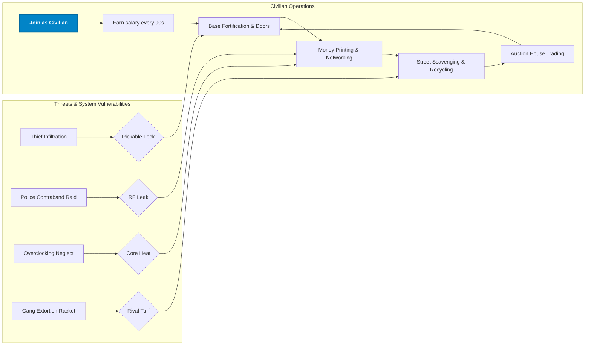
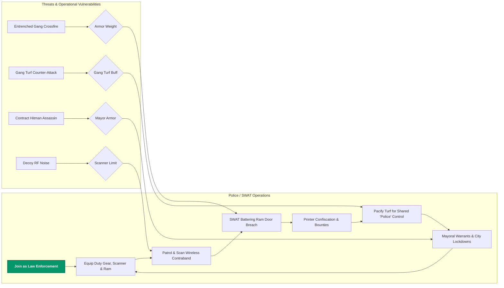
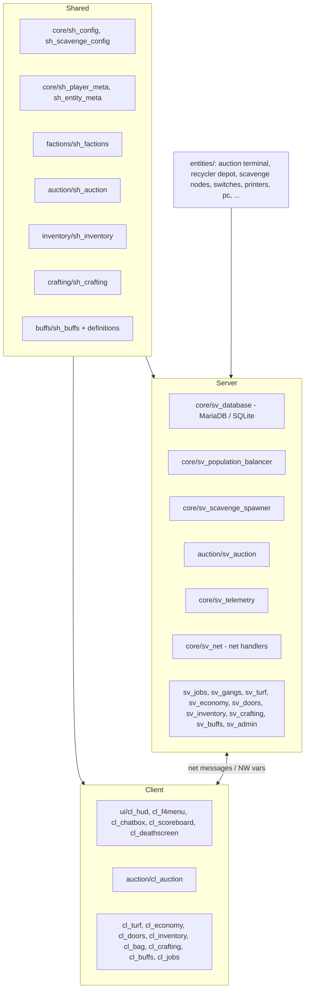
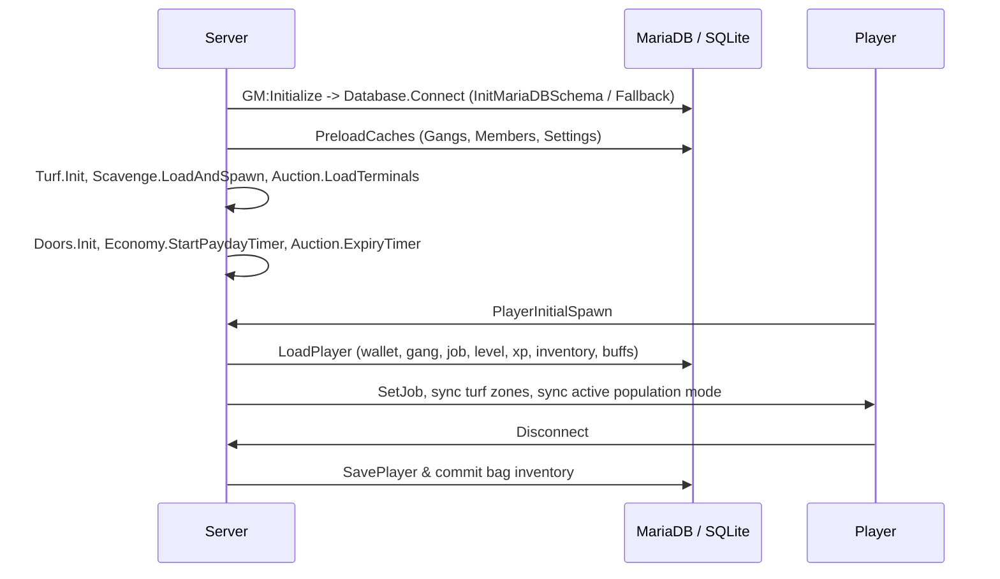
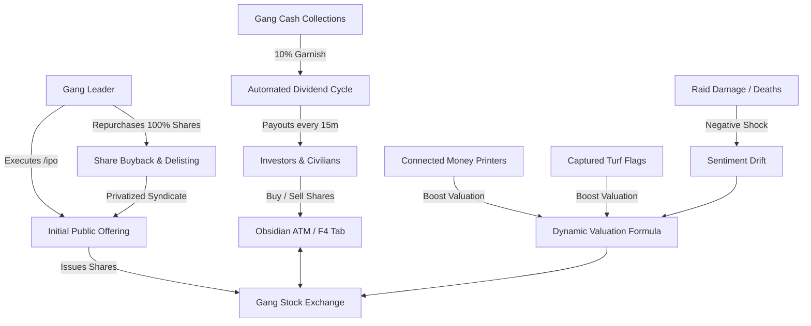
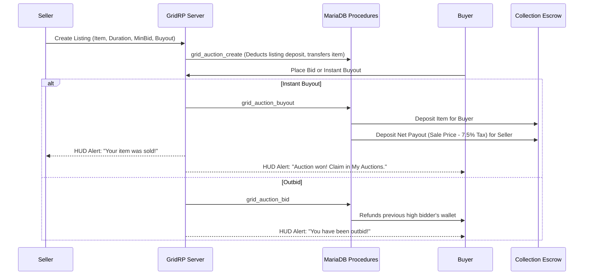

# GridRP (GRID)

**Version:** 2.0.0 (2026) - **Author:** Juicebox - **Base gamemode:** `sandbox` - **Maps:** `^rp_*`

GridRP is a comprehensive, production-grade Garry's Mod roleplay gamemode built around three competing groups: **Citizens** (and specialist service jobs), **Street Gangs**, and **Police/SWAT**. Players earn money from salaries, money printers, scrap scavenging, recycling, crafting, auctions, and territory conquest, then invest into fortified compounds, high-tier weaponry, enterprise networking hardware, and black-market software exploits. Gangs battle over **turf** and levy **protection rackets**, police crack down on **contraband print farms**, Hobos comb the streets for **recyclable scrap**, and Cyber Engineers wage automated cyber-warfare through **Cloud Botnet C2 networks**.

---

## Table of Contents

1. [Features](#features)
2. [Requirements & Installation](#requirements--installation)
3. [Quick Start](#quick-start)
4. [Concept of Operations](#concept-of-operations)
5. [How It Operates (Technical)](#how-it-operates-technical)
   - [Architecture](#architecture)
   - [Boot Sequence & Persistence](#boot-sequence--persistence)
   - [Runtime Loops](#runtime-loops)
   - [Gang Stock Exchange Engine](#gang-stock-exchange-engine)
   - [Citywide Martial Law & Emergency Lockdown](#citywide-martial-law--emergency-lockdown)
   - [Law Enforcement & Multi-Cell Corrections System](#law-enforcement--multi-cell-corrections-system)
   - [Unified Interactive Entity System (`grid_base_interactive`)](#unified-interactive-entity-system-grid_base_interactive)
   - [Persistent World Entity Engine (`GRID.MapSpawns`)](#persistent-world-entity-engine-gridmapspawns)
   - [Onboarding & Syndicate Initiation](#onboarding--syndicate-initiation)
   - [Auction House Engine](#auction-house-engine)
   - [Scavenging & Street Recycling Engine](#scavenging--street-recycling-engine)
   - [Dynamic Population Balancer](#dynamic-population-balancer)
   - [Networking Hardware & Cloud Botnet C2](#networking-hardware--cloud-botnet-c2)
   - [Turf Warfare & Protection Rackets](#turf-warfare--protection-rackets)
   - [Money Printers & Heat Simulation](#money-printers--heat-simulation)
   - [Crafting & Modular Inventory](#crafting--modular-inventory)
   - [Progression](#progression)
6. [Configuration](#configuration)
7. [Commands Reference](#commands-reference)
8. [Jobs Reference](#jobs-reference)
9. [Shop Reference](#shop-reference)
10. [Extending the Gamemode](#extending-the-gamemode)
11. [Project Structure](#project-structure)
12. [Credits & License](#credits--license)

---

## Features

- **Gang Stock Exchange & Public Equity System**: Gang syndicates can launch an Initial Public Offering (IPO) to issue public equity. Real-time dynamic share pricing modeled on active printer yields, territory control, active member count, and combat sentiment shocks. Features interactive line/candlestick charts, ticker tape, ATM banking terminal integration, combat circuit breakers (halts trading for 30s during raids), automated dividend cycles garnishing revenue for shareholders, leader share buybacks, and 100% buyback delisting to allow re-IPOs.
- **Citywide Martial Law & Emergency Lockdown**: Dynamic citywide lockdown triggered whenever a single street gang conquers 100% of all territorial turf. Triggers emergency audio broadcast sirens, an alert banner across the screen-space HUD, and grants law enforcement emergency powers including warrantless property searches and immediate detention.
- **Law Enforcement & Multi-Cell Corrections System**: Comprehensive police overhaul featuring non-lethal conductive Tasers (`weapon_grid_taser`) with ragdoll shock physics, police Stun Batons (`weapon_grid_stunstick`) for instant arrest, crime scene forensic blood/casing investigation, warrant voting, and a persistent multi-cell jail system with dynamic cell allocation (`GRID.Jail.GetBestCell`), real-time sentence countdowns, bail bonds, and admin cell boundary tools.
- **Unified Interactive Entity Base (`grid_base_interactive`)**: Clean object-oriented architecture unifying all world entities (ATMs, computers, flag poles, crafting tables, dead-drop lockers, printers, and scavenge nodes). Replaces cluttered, competing 3D billboard text with unified screen-space HUD interaction prompts and radial sweet-spot venting minigames.
- **Persistent World Entity Engine (`GRID.MapSpawns`)**: Map-agnostic spawner for ATMs, dead-drop lockers, practice stashes, auction terminals, and scavenge nodes with dual MariaDB persistence and JSON file fallback.
- **Onboarding & Tactical Initiation**: Live-fire drone trial and lockpicking initiation pipeline (`GRID.Onboarding`) introducing new recruits to combat mechanics and stealth burglary before full gang clearance.
- **Modernized Obsidian UI Suite**: High-contrast obsidian glassmorphic theme across all Derma dialogs and screen-space HUDs. Features ammo counters, real-time weapon durability bars, color-coded turf extortion tax severity indicators, 16-slot + multi-tier bag inventory grids, and auction collection escrow with 24-hour expiration countdowns.
- **Player-Driven Auction House**: Map-persistent Auction Terminals and integrated F4 tab featuring real-time bidding, instant buyouts, multi-duration listings (12h, 24h, 48h), listing deposit requirements, a 7.5% house transaction tax sink, database collection escrow, and dynamic attribute badges (combat damage/fire rate modifiers, elemental types, durability meters, and crafter signatures).
- **Scavenging & Street Recycling Engine**: World-spawned dumpsters, trash bins, and scrap piles with dynamic respawns, weighted salvage pools, Hobo perks (faster search hold and +15% yield), and Recycler Depots featuring multi-category combo bonuses (up to +25%) and 10% gang bank tributes.
- **Dynamic Population Balancer**: Real-time server monitoring that scales economy mechanics when player counts drop below threshold (<4 players): node cooldowns accelerate (1.5x speed), scavenge loot/cash multipliers increase (1.25x), and territory captures are locked to prevent ghost-town abuse.
- **15 Jobs across 3 Factions**: Citizens and commercial specialists (Pharmacist, Cyber Engineer, Security Contractor, Arms Dealer, Hobo), Street Gangs (Gangster, Gang Leader, Thief, Hitman, Black Market Dealer), and Law Enforcement (Police Officer, Police Chief, SWAT Specialist, Mayor) with tier gates, unique stats, and equipment.
- **Player-Run Gangs & Syndicates**: Complete gang infrastructure with MariaDB-backed rosters, leader privileges, member invites/kicks, shared vault banking with deposit/withdrawal controls, and private gang communication.
- **Turf Warfare & Protection Rackets**: Contested flag poles with 15-second uncontested captures, periodic dividend payouts, real-time police incursion radar alerts, an interactive in-game visual turf editor, and territory protection taxes (5%-30%) automatically levied on civilian printers.
- **Native Networking Stack (No Wiremod Required)**: 4-Port and 7-Port Enterprise L3 Switches with per-port definitions (1G copper, 10G combo SFP, 10G optical uplinks), physical copper and fiber-optic cabling with snap physics, and encrypted Satellite WAN Uplinks.
- **Cyber Layer & Cloud Botnet C2**: Interactive Personal Computer terminal running an in-game Linux-style CLI (`nmap`, `ping`, `hack`, `airmon`, and `botnet`). Cyber Engineers and tech operators deploy automated Cloud Botnet C2 attack daemons via Satellite WAN Uplinks to mine passive revenue scaled directly to connected money printers.
- **Economy & Door Ownership**: Scheduled salary paydays, physical dropped cash stacks, a modernized F4 menu with categorized navigation, job/level restrictions, wholesale markups, and purchasable doors with co-owner management.
- **Money Printers**: Bronze, Silver, and Diamond printers featuring dynamic heat simulation, interactive timing-based vent minigames, hardware modules (Undervolt / Overclock), Cryo-tuning, and police confiscation bounties (+50% for patrol officers).
- **Crafting & Modular Inventory**: Resource Fabricators producing weighted raw materials (Zinc, Iron, Steel, Carbon Rods, Blueprints), crafting recipes for firearms and gear, a 16-slot base backpack, and 4 equippable bag tiers (Satchel, Duffel, Rucksack).
- **Buff/Debuff Engine**: Persistent, stackable status effects (Adrenaline, Health Regen, Wanted, Poison, Taser Stun, and more) that survive player deaths and disconnects.
- **Progression**: Levels 1-50 powered by an MMO-style exponential XP curve (`floor(250 x level^1.65)`) granting cash bonuses upon level-up.
- **Enterprise Persistence**: Production MariaDB (`mysqloo` v9) utilizing 100% Stored Procedures for writes, 12 Analytical Views for real-time reads, in-memory RAM caching, range-partitioned telemetry logging, and automatic SQLite fallback emulation for local singleplayer/listen server development.

---

## Requirements & Installation

### Requirements

- **Server**: Garry's Mod dedicated server (or listen server).
- **Map**: Any `rp_` roleplay map. A default turf profile ships for `rp_downtown_v4c_v2`.
- **Database (Production)**: MariaDB 10.5+ / MySQL 8.0+ with the `mysqloo` v9 binary module installed in `garrysmod/lua/bin/`.
- **Database (Development)**: *Zero setup required.* If `mysqloo` is not detected, GridRP automatically falls back to native SQLite local emulation.
- *(Note: Wiremod is **not** required. All networking, cable routing, and terminal interfaces operate on GridRP's native engine.)*

### Installation

1. Copy the gamemode folder into `garrysmod/gamemodes/gridrp/`. Ensure the folder name matches [gridrp.txt](gridrp.txt).
2. Start the server with:
   ```bash
   srcds.exe -game garrysmod +gamemode gridrp +map rp_downtown_v4c_v2 +maxplayers 32
   ```
3. **Database Setup (MariaDB Production)**:
   - Import the schema into your MariaDB server:
     ```bash
     mysql -u root -p grid < sql/grid_mariadb_schema.sql
     ```
   - Configure database credentials in `garrysmod/data/grid/database.json` or pass startup ConVars:
     ```
     +grid_db_host 127.0.0.1 +grid_db_port 3306 +grid_db_user root +grid_db_password secret +grid_db_database grid
     ```
4. **Initial World Configuration (Admin Setup)**:
   - Join the server and grant yourself `superadmin` status.
   - **Auction Terminals**: Run `grid_spawn_auction_terminal` at key market hubs, then run `grid_save_auction_terminals`.
   - **Scavenging & Recycling**: Place street dumpsters, trash bins, scrap piles, and the Recycler Depot using `grid_scavenge_add <dumpster|trash|scrap|recycler>`, then run `grid_scavenge_save`.
   - **Turf Zones**: Open the visual editor via `/turfsetup` to define territorial capture flag poles, capture radii, and initial faction ownership.

---

## Quick Start

1. **Spawn In**: You spawn as an unemployed **Citizen** with **$250**.
2. **Access Menus**:
   - Press **F4** to open the Command & Commerce Hub (Careers & Jobs, Inventory, Auction House, Rules, Server Guide, Gang Management, and Item Shop).
   - Press **F2** while looking at doors to purchase or co-own properties.
3. **Early Revenue**:
   - Collect your job salary every **90 seconds**.
   - Search street trash bins, dumpsters, and scrap piles by holding **+USE (E)**. Take salvage to the **Recycler Depot** for bonus cash and XP.
   - Buy a **Bronze Money Printer** from the F4 menu, plus a **Copper Wiring Tool** and an **L3 Network Switch** to boost printing efficiency up to 100%.
4. **Join or Found a Syndicate**:
   - Open F4 > Gang Management or type `/creategang <name>` ($200) to create a syndicate.
   - Capture territorial **Flag Poles** across the map for passive dividends every 90 seconds.
   - Set territorial protection taxes (`/settax 5-30`) to levy income from civilian printers operating within your zones.
5. **Trade & Speculate**:
   - Head to an **Auction Terminal** or open F4 > Auction House to bid on rare player-crafted weapons, specialized affixes, and bulk materials.

---

## Concept of Operations

### Faction Viewpoints & Philosophies

GridRP is governed by an adversarial tri-faction ecosystem where commercial enterprise, organized underworld syndicates, and municipal law enforcement constantly clash.

#### 1. Civilian Faction (Commerce, Enterprise & Specialist Services)

- **Core Philosophy:** Capital accumulation, enterprise infrastructure, and free-market opportunism. Civilians construct fortified bases, engineer multi-printer networks, operate automated medical pods, and vend arms or tech.
- **Key Objectives:** Build fortified compounds with keypad doors, maximize money printer networking efficiency (up to 100%), deploy automated Clinic Pods, scavenge street salvage, list valuable loot on the Auction House, and invest in advanced hardware.
- **Faction Interactions:**
  - *Vs. Gangs:* Gangs view civilians as primary targets for burglary, extortion, and territory protection racket taxes (5%-30%). Civilians hire Security Contractors or quiet their operations to avoid attention.
  - *Vs. Police:* Police protect civilian commerce from violent crime, but aggressively search and seize unregistered money print farms (+50% cash bounty to patrol officers).

#### 2. Street Gangs Faction (Territory, Extortion & Syndication)

- **Core Philosophy:** Collective dominance, territorial sovereignty, and predatory extraction. Street gangs reject state authority, leveraging armed syndicates to seize public turf, extort local commerce, and traffic illegal contraband.
- **Key Objectives:** Form player syndicates (`/creategang`), conquer and defend flag poles for passive dividends, levy protection taxes (`/settax 5-30`), crack civilian vaults with tactical lockpicks, and execute contract hits.
- **Faction Interactions:**
  - *Vs. Civilians:* Civilians are revenue sources to be shaken down for protection taxes, raided for printer loot, or serviced with illicit weapons and stims.
  - *Vs. Police:* Police are direct operational adversaries. Gangs gain a **Turf Defender Bonus** (+$100 and +100 XP per officer slain on claimed territory). However, criminal acts inflict persistent *Wanted* status that survives death and disconnects.

#### 3. Police / SWAT Faction (Order, Interdiction & Civil Protection)

- **Core Philosophy:** Urban pacification, contraband interdiction, and strict civil defense. Law enforcement maintains city stability by breaking organized crime syndicates, neutralizing illegal money print farms, and upholding the Mayor's authority.
- **Key Objectives:** Patrol urban sectors with wireless Contraband Scanners, execute dynamic tactical breaches using the SWAT Battering Ram, neutralize illegal printers for cash bounties, capture territory under the unified `"Police"` claimant, and enforce citywide lockdowns.
- **Faction Interactions:**
  - *Vs. Civilians:* Civilians are citizens under state protection, yet are subject to scanning, perimeter checks, and property raids if contraband signals are detected.
  - *Vs. Gangs:* Gangs are armed combatants to be neutralized, disarmed, and pushed out of occupied urban territories.

---

### Core Gameplay Loops & Threat Models

#### Civilian Faction Capability & Threat Model



#### Street Gangs Faction Capability & Threat Model


#### Police / SWAT Faction Capability & Threat Model



---

## How It Operates (Technical)

### Architecture



### Boot Sequence & Persistence



### Runtime Loops

| Loop | Interval | Subsystem | Operational Effect |
| :--- | :--- | :--- | :--- |
| **Payday** | 90 s | `sv_economy` | Each player receives their job salary. |
| **Turf Dividends** | 90 s | `sv_turf` | Online members of an owning gang (or Police) receive $25 per owned turf and 25 XP. |
| **Stock Dividend Cycle** | 900 s | `sv_stocks` | Garnishes gang earnings to distribute dividend payouts across public stock shareholders. |
| **Stock History Snapshot** | 60 s | `sv_stocks` | Records price points for candlestick and line chart rendering. |
| **Jail Sentence Tick** | 1 s | `sv_jail` | Decrements active prison sentences and checks bail release conditions. |
| **Printer Cycle** | 20 s | `grid_printer_base` | Adds `PrintAmount x efficiency` to stored cash and raises core temperature. |
| **Botnet C2 Cycle** | 20 s | `grid_computer` | Generates passive botnet revenue based on connected money printers and Cyber Engineer perk. |
| **Auction Expirations** | 60 s | `sv_auction` | Sweeps active listings; expired lots are placed in escrow collection via stored procedure. |
| **Population Balance** | 30 s | `sv_population_balancer` | Evaluates player counts, toggling low-pop mode (<4 players) with dynamic multipliers and alerts. |
| **Buff Ticks** | Per buff | `sv_buffs` | Processes persistent HoT, poison, taser stuns, and wanted status timers. |

---

### Gang Stock Exchange Engine

The Gang Stock Exchange (`gamemode/stocks/`) introduces a decentralized public equity market where street gangs can list corporate shares, raise capital through Initial Public Offerings (IPOs), and speculate on rival syndicate operations.



- **Initial Public Offering (IPO)**: Gang leaders with sufficient standing can list their gang on the exchange via an ATM or `/ipo`, selecting an initial share issuance (up to 1,000 public shares) and opening public trading.
- **Dynamic Pricing Formula**: Share prices update algorithmically in real time:
  ```
  Price = max(MinPrice, BasePrice + (Printers * PrinterWeight) + (TurfCount * TurfWeight) + (Members * MemberWeight) + SentimentModifier)
  ```
  - **Printers**: Active, connected money printers provide fundamental production backing.
  - **Turf Domination**: Each captured territory flag pole contributes immediate real-estate valuation.
  - **Sentiment Shocks**: Slaying rival gang members provides positive market sentiment, while member fatalities and lost territories inflict negative sentiment shocks that decay back to zero over time.
- **Combat Circuit Breakers**: When any member of a publicly traded gang takes combat damage or is killed, trading on that gang's shares is immediately halted for 30 seconds (`GRID.Stocks.TriggerCombatHalt`).
- **Automated Dividend Cycle**: Every 15 minutes (`GRID.Config.Stocks.DividendInterval`), `GRID.Stocks.ProcessDividendCycle()` garnishes 10% of the gang's revenue and distributes cash dividends proportionally across all public shareholders.
- **Share Buybacks & Delisting**: Gang leaders can execute share buybacks at current market prices using gang vault funds. If a syndicate repurchases 100% of its publicly issued shares, the company is automatically delisted and returned to private ownership, unlocking the ability to execute a fresh IPO.
- **Glassmorphic Trading Interface**: Integrated into physical Obsidian ATM terminals and the F4 menu. Displays live candlestick and line charts across selectable timeframes (5m, 15m, 1h, All), real-time order books, portfolio holdings, available share counters, and price alert tickers.

---

### Citywide Martial Law & Emergency Lockdown

GridRP features a dynamic, server-wide Martial Law system monitored by `sv_turf.lua`.

- **Trigger Condition**: Martial Law is automatically declared when a single street gang conquers 100% of all territory flag poles across the map, achieving total territorial hegemony.
- **Atmospheric Emergency Alert**:
  - A citywide emergency warning siren echoes across the map.
  - A persistent, high-contrast emergency banner HUD strip pins to the top of every player's screen with flashing status advisories.
  - Radio dispatch broadcasts orders to all municipal units.
- **Emergency Powers & Legal Mechanics**:
  - **Curfew Enforcement**: All civilians are ordered to remain indoors; unescorted individuals on public streets are designated as high-risk curfew violators.
  - **Warrantless Search & Seizure**: Police officers are granted temporary authorization to search civilian properties and detain suspects without prior warrant votes.
  - **Interdiction Bounties**: Police earn increased cash and XP bounties for neutralizing gang members and liberating contested flag poles during the lockdown.

---

### Law Enforcement & Multi-Cell Corrections System

The law enforcement suite (`gamemode/police/`) provides non-lethal apprehension tools, dynamic investigations, and a persistent correctional facility engine.

- **Non-Lethal Conductive Taser (`weapon_grid_taser`)**: Fires electrified twin-dart probes. Upon contact, targets undergo immediate electro-muscular disruption, collapsing into an involuntary physical ragdoll for 5 seconds with screen distortion and electrical crackle audio before recovering.
- **Police Stun Baton (`weapon_grid_stunstick`)**: Secondary attack immediately restrains wanted suspects on contact, initiating instant booking and transfer into the municipal corrections system.
- **Persistent Multi-Cell Jail System**:
  - **Optimal Cell Allocation (`GRID.Jail.GetBestCell`)**: Dynamic routing algorithm automatically allocates incoming prisoners to the jail cell with the lowest current occupancy to prevent overcrowding.
  - **Real-Time Sentence Countdowns**: Prison sentences scale based on accumulated crimes and Wanted star ratings, decrementing by 1 second on each server tick. Sentences persist across player disconnects, reconnects, and map cleanups via MariaDB records.
  - **Bail Bond Mechanics (`GRID.Jail.PayBail`)**: Inmates or their associates can pay calculated cash bail at the jail terminal or an ATM to erase their remaining sentence and trigger immediate release.
  - **Admin Setup & Calibration**: Administrators can configure cell spawn points and release drop zones using `grid_jail_setcell <id>`, `grid_jail_setrelease`, and `grid_jail_clear`.
- **Crime Scene Investigation & Forensic Evidence**: Firefights dynamically generate blood splatters and spent ballistic bullet casings in world space. Police can inspect forensic markers to identify shooter identities and murder weapons.
- **Democratic Warrant Voting**: Officers can initiate warrant voting (`/warrant <player> <reason>`), allowing online law enforcement personnel to review evidence and cast real-time votes before authorizing high-risk SWAT compound raids.

---

### Unified Interactive Entity System (`grid_base_interactive`)

To eliminate visual clutter and establish consistent object-oriented entity interactions, GridRP consolidates all world props and interactive machines into a unified base entity (`grid_base_interactive`).

- **Anti-Billboard UX Philosophy**: Traditional floating 3D2D world-space text overlays create visual clutter and tank client render frame rates. `grid_base_interactive` completely eliminates in-world 3D billboards in favor of clean, screen-space HUD interaction prompts rendered only when looking directly at an entity within reach (80-120 units).
- **Inherited World Entities**: The base powers ATMs, computers, flag poles, crafting tables, dead-drop lockers, practice stashes, money printers, and street scavenge containers.
- **Screen-Space Sweet-Spot Venting Minigame**: For high-stress interactions such as venting overheating money printers, the entity activates a responsive screen-space HUD gauge. Players press and hold **+USE (E)** to open cooling valves, then release precisely within a moving green sweet spot to safely vent heat without jamming the machine.

---

### Persistent World Entity Engine (`GRID.MapSpawns`)

Implemented in `gamemode/core/sv_mapspawns.lua`, `GRID.MapSpawns` provides an enterprise world persistence architecture that automates utility entity lifecycle management.

- **Automated Lifecycle**: Spawns and tracks ATMs, dead-drop lockers, practice stashes, auction terminals, and scavenge nodes across server boots and `PostCleanupMap` resets.
- **Dual Persistence Architecture**: Entity transform coordinates, angles, and configuration options are written atomically to MariaDB (`grid_map_spawns`) and mirrored into `garrysmod/data/grid/spawns/<map>.json` for zero-configuration listen server and singleplayer development.
- **Admin In-World Spawners**: Administrators can reposition and persist entities with a single command (`grid_spawn_atm`, `grid_save_atms`, `grid_spawn_locker`, `grid_save_lockers`, `grid_spawn_stash`, `grid_save_stashes`).

---

### Onboarding & Syndicate Initiation

The initiation pipeline (`GRID.Onboarding`) replaces tedious starter tutorials with a fast-paced, tactical stage-based clearance pipeline:

1. **Stage 0 (City Arrival)**: New players spawn in the transit terminal with essential starting cash and guidance on accessing city services.
2. **Stage 1 (Burglary & Lockpicking)**: Recruits locate a hidden Practice Stash (`grid_practice_stash`) and crack its tumblers using a tactical lockpick to acquire starter contraband.
3. **Stage 2 (Live-Fire Tactical Drone Drill)**: Recruits engage automated training drones in a live-fire weapon handling trial, proving aim tracking, recoil mitigation, and cover discipline under live fire.
4. **Stage 3 (Dead-Drop Extraction)**: Operatives deliver acquired materials to a secure Dead-Drop Locker (`grid_deaddrop_locker`), proving their ability to navigate city surveillance.
5. **Stage 4 (Syndicate Clearance)**: Recruits achieve full civilian/syndicate clearance, unlocking gang creation privileges, high-tier black-market weapons, and Auction House listings.

---

---

### Auction House Engine

GridRP features a fully decentralized, player-driven Auction House integrated into both physical world terminals (`grid_auction_terminal`) and the F4 Menu (`Auction House` tab).



- **Listing Durations**: 12 Hours (2% deposit), 24 Hours (4% deposit), 48 Hours (6% deposit). Minimum listing deposit is **$100**. Deposits are refunded upon successful sale.
- **Economic Sinks**: A flat **7.5% sales tax** is automatically deducted from every completed auction payout.
- **Collection Escrow (`grid_auction_collection`)**: Items and currency won or expired are placed into a safe collection escrow. Players claim their winnings directly through the **My Auctions** tab.
- **Dynamic Attribute Badges**: The auction UI dynamically parses and renders custom item data, including rolled combat stats (`+% Damage`, `+% Fire Rate`), elemental affixes (`Fire`, `Electric`, `Poison`), durability meters (`Current / Max`), and crafter signatures.

---

### Scavenging & Street Recycling Engine

Players can scavenge urban refuse nodes across the city and convert collected junk into cash, XP, and gang bank reserves at the **Recycler Depot**.

- **Scavenge Node Types**:
  - `grid_scavenge_dumpster`: High-tier container with higher cash and rare junk yields (5-minute base cooldown).
  - `grid_scavenge_trashbin`: Rapid-respawn street container (2.5-minute base cooldown).
  - `grid_scavenge_scrappile`: Industrial metal and electronic salvage (4-minute base cooldown).
- **Search Mechanics**: Hold **+USE (E)** within 110 units for 1.5 seconds (reduced to **1.2 seconds** for Hobos). Moving or releasing the key aborts the search.
- **Recycler Depot (`grid_recycler_depot`)**:
  - Accepts 5 distinct material categories: Scrap Metal, Gunpowder Residue, Broken Electronics, Plastic Bottles, and Aluminum Cans.
  - **Combo Bonus**: Depositing multiple distinct scrap categories simultaneously grants **+5% bonus payout per category** (capped at **+25%** for all 5).
  - **Gang Bank Tribute**: Depositing recyclables awards a matching **10% cash bonus directly into the player's gang bank vault**.

---

### Dynamic Population Balancer

GridRP includes an automated population balancer (`sv_population_balancer.lua`) that monitors active player counts:

- **Low Population Mode (< 4 Players)**:
  - **Node Respawn Rate**: Scavenge node cooldowns are reduced by **33.3%** (1.5x faster node respawns).
  - **Loot & Cash Yield**: All scavenged items and cash drops receive a **+25% yield bonus** (1.25x multiplier).
  - **Turf Warfare Lock**: Territory flag pole captures are automatically locked when fewer than 4 players are online to prevent offline ghost-town exploitation (configurable via `AllowLowPopTurfCapture`).
- **Standard Population Mode (>= 4 Players)**: Standard cooldowns and economy multipliers resume automatically, broadcasting a notification to all players.

---

### Networking Hardware & Cloud Botnet C2

GridRP implements an enterprise networking model directly within Lua, completely removing external dependencies like Wiremod.

- **Layer-3 Switches**:
  - **4-Port Switch (`grid_network_switch_4p`)**: 2 Dedicated Copper ports (1G), 1 SFP Combo port (10G/1G), and 1 SFP 10G optical uplink.
  - **7-Port Enterprise Switch (`grid_network_switch_7p`)**: 5 Dedicated Copper ports (1G), 1 SFP Combo port (10G/1G), and 1 SFP 10G optical uplink.
- **Cables & Snapping**:
  - **Copper Patch Cables**: Max length 550 units.
  - **Fiber-Optic Cables**: Max length 800 units. Exceeding max distance snaps the cable.
- **Satellite WAN Uplink (`grid_wan_uplink`)**: Connects separate local switches wirelessly across buildings using encrypted frequency keys.
- **Personal Computer (`grid_computer`) & Botnet C2**:
  - Interactive Unix-style terminal interface (`help`, `status`, `nmap`, `ping`, `hack`, `airmon`, `botnet`).
  - **Cloud Botnet C2 Daemon**: Operators can type `botnet start` to launch an automated attack daemon. The botnet routes through the connected Satellite WAN Uplink, monetizing unused network throughput.
  - **Yield Scaling**: Generates passive cash every 20 seconds, scaling with the number of networked money printers (up to 3 counted), with a **+25% efficiency bonus for Cyber Engineers**.
  - **Counterplay & Risk**: Active botnet traffic illuminates the Satellite WAN Uplink on wireless `airmon` scans across the map, advertising your base location to rival hackers and police.

---

### Turf Warfare & Protection Rackets

- **Territory Capture**: Gang members or Police capture flag poles by pressing **+USE (E)** and holding position within 450 units for 15 uncontested seconds. Capturing awards **$40 and 150 XP**.
- **Dividends**: Holding territory generates **$25 and 25 XP** every 90 seconds for all online gang members (or police officers).
- **Protection Rackets**: Gang Leaders can adjust the territory tax rate (`/settax 5-30`). Any civilian money printer operating within the boundaries of a gang's controlled territory is subject to this tax upon cash collection, funneling money directly into the controlling gang's vault.
- **Police Incursion Alerts**: When law enforcement officers step into claimed gang territory, all online members of the controlling syndicate receive real-time audio and HUD alert banners.
- **Turf Defender Bonus**: Gang members defending their claimed territory earn an extra **+$100 and +100 XP** for every police officer neutralized within the zone.

---

### Money Printers & Heat Simulation

- **Tiers & Base Yields** (per 20-second cycle at 100% efficiency):
  - **Bronze Printer**: $4 base yield ($12/min).
  - **Silver Printer** (Level 4): $10 base yield ($30/min).
  - **Diamond Printer** (Level 8): $25 base yield ($75/min).
- **Efficiency Scaling**: 60% standalone, 80% with 2 printers on an L3 switch, 100% with 3 or more printers networked.
- **Hardware Modules**:
  - **Overclock Module**: +50% yield, +3 heat per cycle.
  - **Undervolt Module**: Reduces heat generation per cycle from 4 to 1.
  - **Cryo Calibrator (Cyber Engineer)**: +20% yield, -25% heat.
- **Heat & Venting**: Printers reaching **100  deg C** explode. Press **E** to initiate the venting cycle, then press **E** again inside the green sweet spot to vent heat. Failing jams the valve and spikes temperature.
- **Police Interdiction**: Law enforcement officers earn a **$125 base bounty** (+50% bonus = **$187 for Patrol Officers**) upon confiscating illegal printers.

---

### Crafting & Modular Inventory

- **Resource Fabricators**: Deployable machines producing raw crafting materials on a weighted drop table:
  `Zinc (48%)` - `Iron (24%)` - `Steel (12%)` - `Weapon Blueprints (10%)` - `Carbon Rods (6%)`.
- **Recipes**: Craft firearms (Glock, Shotgun, Deagle, AK-47), tactical bags, and equipment in the Crafting menu.
- **Modular Bag Inventory**:
  - Base Backpack: 16 slots.
  - Equippable Bags: Satchel (+6 slots), Duffel (+10 slots), Rucksack (+16 slots).
  - Full item persistence with atomic database saving.

---

### Progression

- **XP Formula**: Required XP to next level = `floor(250 x level^1.65)`. Maximum Level: **50**.
- **XP Sources**:
  - Player Kill: +50 XP (+50 bonus for rival gang members).
  - Turf Capture: +150 XP.
  - Turf Dividend Tick: +25 XP.
  - Printer Cash Collection: +20 XP.
  - Street Scavenging & Recycling: +5 to +25 XP per item.
- **Level-Up Reward**: Awards **$500 x new level** directly to the player's wallet.

---

## Configuration

Core configuration files are located in `gamemode/core/sh_config.lua`, `gamemode/police/sh_jail.lua`, and `gamemode/core/sh_scavenge_config.lua`.

| ConVar / Setting | Default | Description |
| :--- | :--- | :--- |
| `StartingMoney` | 250 | Initial player wallet balance on first spawn. |
| `PaydayInterval` | 90 | Seconds between salary paydays. |
| `DropMoneyOnDeathMax` | 75 | Maximum cash dropped on death (10% of wallet, capped). |
| `GangCreationCost` | 200 | Cost to found a gang syndicate via `/creategang`. |
| `TurfCaptureRadius` | 450 | Distance (units) players must remain within to capture a flag pole. |
| `TurfCaptureTime` | 15 | Uncontested seconds required to complete a turf capture. |
| `TurfDividendInterval` | 90 | Seconds between turf dividend payouts. |
| `TurfDividendAmount` | 25 | Cash and XP awarded per held turf zone per dividend cycle. |
| `TurfCaptureReward` | 40 | Instant cash bonus awarded to the capturer upon claiming turf. |
| `MaxCableLength` | 550 | Max length (units) for Copper network cables before snapping. |
| `MaxFiberCableLength` | 800 | Max length (units) for Fiber-Optic network cables before snapping. |
| `WLANSniffMaxDistance` | 2500 | Max scanning range for wireless airmon / scanner recon. |
| `Auction.SalesTaxRate` | 0.075 | House transaction tax (7.5%) deducted from auction sales. |
| `Auction.MinDeposit` | 100 | Minimum listing deposit required to list an auction. |
| `Scavenge.SearchDuration`| 1.5 | Search hold duration (seconds) for scavenging containers. |
| `Population.Threshold` | 4 | Minimum player count before Low Population mode activates. |
| `BotnetBaseTrickle` | 2 | Minimum base cycle payout for the Cloud Botnet C2 daemon. |
| `BotnetMaxCountedPrinters`| 3 | Maximum networked money printers that scale botnet yield. |
| `DefaultShopMarkupPercent` | 65 | Retail markup applied to player vendor kiosks. |
| `Stocks.TotalShares` | 1000 | Total shares issued per syndicate on the Gang Stock Exchange. |
| `Stocks.MaxSharesForSalePct` | 0.49 | Maximum portion of shares (490 shares) available for public float. |
| `Stocks.MinVaultForIPO` | 10000 | Minimum gang vault balance required to launch an IPO. |
| `Stocks.IPOListingFeeFlat` | 1500 | Burned listing fee sink deducted upon IPO execution. |
| `Stocks.DividendInterval` | 900 | Seconds between automated dividend cycles (15 minutes). |
| `Stocks.CombatHaltDuration` | 30 | Seconds trading is halted when a gang member is injured or killed. |
| `Stocks.SentimentDecayRate` | 0.10 | Decay rate per cycle restoring sentiment to 1.0x baseline. |
| `Jail.DefaultSentence` | 90 | Base prison sentence duration (seconds) per booking. |
| `Jail.DefaultBail` | 500 | Base cash bail bond cost to purchase immediate jail release. |

---

## Commands Reference

### Player Commands

| Command | Binding / Shortcut | Description |
| :--- | :--- | :--- |
| **F4** | Keyboard Key | Opens the Command & Commerce Hub (Jobs, Inventory, Auction, Stocks, Rules, Guide, Gang, Shop). |
| **F2** | Keyboard Key | Opens the Door / Property Management menu. |
| `/inv`, `/inventory`, `/bag` | Chat | Opens your character backpack and bag inventory. |
| `/dropmoney <amount>` | Chat | Drops a physical stack of cash at your crosshair. |
| `/drop`, `/dropweapon` | Chat | Drops the currently equipped weapon on the ground. |

### Gang & Market Commands

| Command | Description |
| :--- | :--- |
| `/creategang <name>` | Founds a new syndicate ($200, 2-24 characters). |
| `/invitegang <player>` | Invites a player to join your syndicate. |
| `/acceptgang` | Accepts a pending syndicate invitation. |
| `/leavegang` | Leaves your current syndicate. |
| `/disbandgang` | Disbands the syndicate (Leader only). |
| `/gang` | Displays gang roster, bank vault balance, and controlled turfs. |
| `/gang deposit <amount>` | Deposits personal cash into the syndicate vault. |
| `/gang withdraw <amount>`| Withdraws funds from the syndicate vault (Leader only). |
| `/settax <5-30>` | Sets territory protection tax rate on civilian printers (Leader only). |
| `/g <message>`, `/gangchat` | Sends a private message to all online gang members. |
| `/ipo` | Opens the IPO registration panel at an ATM or F4 Stock tab (Leader only). |
| `/buyback <shares>` | Repurchases public shares using gang bank vault funds (Leader only). |

### Law Enforcement Commands

| Command | Description |
| :--- | :--- |
| `/wanted <player> [reason]` | Issues a formal Wanted warrant for a suspect (survives disconnects). |
| `/unwanted <player>` | Revokes an active Wanted warrant for a player. |
| `/warrant <player> [reason]` | Initiates a democratic warrant vote among all online police officers. |
| `/lockdown` | Declares or terminates Citywide Martial Law (Mayor or Admin only; requires 100% gang turf control). |

### PC Terminal CLI Commands

| Command | Usage | Description |
| :--- | :--- | :--- |
| `help` | `help [cmd]` | Lists available terminal commands and syntax. |
| `status` | `status` | Displays terminal host IP, switch link, and WAN connection. |
| `nmap` | `nmap` | Scans the local Layer-3 switch broadcast domain for devices. |
| `ping` | `ping <ip>` | Tests network connectivity to a specific target IP. |
| `airmon` | `airmon` | Scans wireless airspace for active Satellite WAN Uplinks. |
| `hack` / `crack` | `crack <ip>` | Attempts cryptographic key extraction on remote WAN uplinks. |
| `botnet start` | `botnet start` | Launches the automated Cloud Botnet C2 mining daemon. |
| `botnet stop` | `botnet stop` | Gracefully halts the botnet daemon and drops C2 traffic. |
| `botnet status`| `botnet status` | Inspects connected compute nodes and projected revenue rate. |
| `botnet collect`| `botnet collect` | Withdraws accumulated botnet revenue directly into your wallet. |

### Administrator Commands (`admin` or `superadmin`)

| Command | Console / Chat | Description |
| :--- | :--- | :--- |
| `/admin`, `/debug`, `grid_admin` | Both | Opens the interactive Admin Management & Debug HUD. Features live role inspection, item debugging, full player database reset (`reset_player`), and holding cell management. |
| `/turfsetup`, `/adminsetup`, `grid_turfsetup` | Both | Opens the in-game visual Turf Setup & Zone Editor. |
| `Physgun + USE` | In-World | Holding a Physgun and pressing **+USE (E)** on any persistent entity opens the live Visual Infrastructure Configurator. |
| `/setmoney <player> <amount>` | Chat | Sets a target player's wallet balance. |
| `/addmoney <player> <amount>` | Chat | Grants cash to a target player's wallet. |
| `/setlevel <player> <level>` | Chat (`grid_setlevel`) | Sets a target player's level. |
| `/addxp <player> <amount>` | Chat (`grid_addxp`) | Grants XP to a target player. |
| `grid_mapspawns_copy <map>` | Console | Copies persistent world spawns from a source map profile to the active map. |
| `grid_spawn_auction_terminal` | Console | Spawns an Auction Terminal at crosshair and persists to map. |
| `grid_save_auction_terminals` | Console | Saves all current Auction Terminals to the map profile. |
| `grid_scavenge_add <type>` | Console | Spawns and persists a scavenge node (`dumpster`, `trash`, `scrap`, `recycler`). |
| `grid_scavenge_save` | Console | Saves all scavenge nodes and recyclers to Database & Map JSON. |
| `grid_scavenge_respawn` | Console | Reloads and respawns all scavenge nodes from Database/JSON. |
| `grid_scavenge_clear` | Console | Clears all scavenge nodes from the active map. |

---

## Jobs Reference

Every job receives baseline items (`weapon_fists`, `weapon_grid_keys`, `weapon_physgun`, `weapon_physcannon`, `gmod_tool`). Police spawn with duty ammunition and have a rapid 5-second respawn timer (15 seconds for all other factions).

### 1. Civilian & Specialty Services Faction

| Job & Tier | Stats & Loadout | Core Capabilities & Exclusive Mechanics |
| :--- | :--- | :--- |
| **Citizen**<br>`Lvl 1 - $6/90s - INF slots` | - Armor: 0<br>- Speed: 160 / 240<br>- Weapons: Fists | Base construction, money printer farming, resource gathering, door ownership. Baseline commerce partner. |
| **Pharmacist**<br>`Lvl 1 - $12/90s - 3 slots` | - Armor: 0<br>- Speed: 160 / 240<br>- Weapons: Medkit | Deploys automated **Triage Clinic Pods**; dispenses field heals & Adrenaline stim buffs for passive profits. |
| **Cyber Engineer**<br>`Lvl 3 - $14/90s - 3 slots` | - Armor: 10<br>- Speed: 160 / 240<br>- Weapons: Wiretool | Networks printers, optimizes hardware with **Cryo Calibrator** (+20% yield, -25% heat), wireless terminal exploits, and **+25% Botnet C2 yield bonus**. |
| **Security Contractor**<br>`Lvl 2 - $13/90s - 4 slots` | - Armor: 50<br>- Speed: 160 / 240<br>- Weapons: Stunstick | Hired protection specialist with high base armor; guards printer vaults, stores, and VIP compounds. |
| **Arms Dealer**<br>`Lvl 2 - $10/90s - 3 slots` | - Armor: 0<br>- Speed: 160 / 240<br>- Weapons: Fists | Authorized gun merchant; orders wholesale weapon shipments (Glock, Shotgun), ammo crates, Kevlar vests. |
| **Hobo**<br>`Lvl 1 - $0/90s - 4 slots` | - Armor: 0<br>- Speed: 160 / 240<br>- Weapons: Bugbait | Master scavenger; **faster search duration (1.2s)**, **+15% scavenging loot yield**, exempt from territory taxes and printer bounties. |

### 2. Street Gangs & Underworld Faction

| Job & Tier | Stats & Loadout | Core Capabilities & Exclusive Mechanics |
| :--- | :--- | :--- |
| **Gangster**<br>`Lvl 1 - $10/90s - 16 slots` | - Armor: 0<br>- Speed: 160 / 240<br>- Weapons: Fists | Frontline soldier; joins syndicates, contests flag poles, defends printers. Gains **+$100/100XP Turf Defender bonus** per slain cop on claimed turf. |
| **Gang Leader**<br>`Lvl 5 - $20/90s - 4 slots` | - Armor: 50<br>- Speed: 160 / 240<br>- Weapons: Fists | Syndicate founder; executes `/creategang`, withdraws vault funds, sets territory tax (`/settax 5-30`), and coordinates turf defense. |
| **Thief**<br>`Lvl 3 - $10/90s - 4 slots` | - Armor: 0<br>- Speed: 160 / 240<br>- Weapons: Lockpick | Infiltrator; bypasses door keypads with lockpicks to crack vaults, extract contraband, and steal cash. |
| **Hitman**<br>`Lvl 6 - $16/90s - 2 slots` | - Armor: 30<br>- Speed: 160 / 240<br>- Weapons: Lockpick | Covert assassin; accepts targeted murder contracts, stealth infiltration, high-precision executions. |
| **Black Market Dealer**<br>`Lvl 4 - $12/90s - 2 slots` | - Armor: 0<br>- Speed: 160 / 240<br>- Weapons: Fists | Contraband smuggler; exclusive vendor of heavy weapons (AK-47, Deagle shipments), lockpicks, and combat stims. |

### 3. Police / SWAT Faction

| Job & Tier | Stats & Loadout | Core Capabilities & Exclusive Mechanics |
| :--- | :--- | :--- |
| **Police Officer**<br>`Lvl 1 - $16/90s - 6 slots` | - Armor: 30<br>- Speed: **230 / 350**<br>- Weapons: Glock, Stunstick, Taser, Scanner | Rapid pursuit interceptor (top 350 sprint speed); scans wireless contraband, earns **+50% printer bounties**, 5s rapid respawn timer. |
| **Police Chief**<br>`Lvl 5 - $25/90s - 1 slot` | - Armor: 50<br>- Speed: 220 / 315<br>- Weapons: Deagle, Shotgun, Stunstick, Taser | Tactical commander; coordinates street patrols, issues warrants, initiates city lockdowns. |
| **SWAT Specialist**<br>`Lvl 7 - $22/90s - 2 slots` | - Armor: **100**<br>- Speed: **160 / 230**<br>- Weapons: Shotgun, Battering Ram, Stunstick, Taser | Heavy siege breacher; instant dynamic door breaches with **Battering Ram**, absorbs heavy damage. Heavy speed penalty. |
| **Mayor**<br>`Lvl 5 - $35/90s - 1 slot` | - Armor: 25<br>- Speed: 160 / 240<br>- Weapons: Deagle | Chief executive; declares citywide curfews, signs search warrants, manages public governance. High-value VIP target. |

---

## Shop Reference

| Category | Available Goods & Hardware |
| :--- | :--- |
| **Ammo & Gear** | Universal Pistol/Rifle/Shotgun Ammo, Kevlar Vest (100 Armor), Tactical Lockpick. |
| **Printers & Tech** | Bronze Printer ($250), Silver Printer ($750, Lvl 4), Diamond Printer ($2,200, Lvl 8), Resource Fabricator ($500, Lvl 2). |
| **Shipments** | Bulk Weapon Shipments: Glock 18, Shotgun (Arms Dealer); Desert Eagle, AK-47, Lockpicks (Black Market Dealer). |
| **Networking** | Copper Wiring Tool, Cryo Calibrator, 4-Port L3 Switch, 7-Port Enterprise L3 Switch, Personal Computer, Satellite WAN Uplink, CyberDeck Phone, Undervolt Module, Overclock Module. |
| **Supplies & Items**| Bandage, First Aid Kit, Medical Triage Clinic Pod, Handheld Medkit, Scavenged Materials. |
| **Admin / Debug** | `[DEBUG]` buff/debuff injectors and entity test items (restricted to administrators). |

---

## Extending the Gamemode

- **Add a Job**: Add a new table entry to `GRID.Jobs` in [gamemode/factions/sh_factions.lua](gamemode/factions/sh_factions.lua) specifying name, level, faction, salary, weapons, model, max slots, and description.
- **Add a Shop Item**: Append an item definition to `GRID.ShopItems` in [gamemode/core/sh_config.lua](gamemode/core/sh_config.lua) specifying category, price, job restrictions, and model.
- **Add a Crafting Recipe or Material**: Edit `GRID.Crafting.Materials`, `DropTable`, and `Recipes` in [gamemode/crafting/sh_crafting.lua](gamemode/crafting/sh_crafting.lua).
- **Add a Recyclable Material**: Register new scrap items in `GRID.Scavenge.Recyclables` within [gamemode/core/sh_scavenge_config.lua](gamemode/core/sh_scavenge_config.lua) with cash, XP, and category values.
- **Add a Status Buff/Debuff**: Call `GRID.Buffs.Register(id, {...})` in [gamemode/buffs/sh_buff_definitions.lua](gamemode/buffs/sh_buff_definitions.lua). Supported hooks include `OnApplied`, `OnTick`, `OnRemoved`, `ModifySpeed`, and `ModifyDamageTaken`.
- **Add a Database Mutation**: Stored procedures reside in [sql/grid_mariadb_schema.sql](sql/grid_mariadb_schema.sql). Add procedure declarations and wrap them in [gamemode/core/sv_database.lua](gamemode/core/sv_database.lua) with matching SQLite emulation fallbacks.

---

## Project Structure

```
gridrp/
|---- gridrp.txt                      # Gamemode manifest & configuration
|---- README.md                       # Comprehensive system documentation
|---- sql/
|   \---- grid_mariadb_schema.sql     # Complete MariaDB schema (Procedures & Views)
|---- gamemode/
|   |---- init.lua, cl_init.lua, shared.lua
|   |---- stocks/                     # Gang Stock Exchange & Equity System
|   |   |---- sh_stocks.lua           # Valuation models, pricing constants, network IDs
|   |   |---- sv_stocks.lua           # Market lifecycle, dividends, circuit breakers, buybacks
|   |   \---- cl_stocks.lua           # Real-time chart renderer, ticker tape & ATM VGUI
|   |---- police/                     # Law enforcement & correctional facilities
|   |   |---- sh_jail.lua             # Shared jail metadata & sentence formulas
|   |   |---- sv_jail.lua             # Multi-cell allocation, persistent timers, bail bonds
|   |   |---- cl_jail.lua             # Inmate HUD sentence display & bail dialogue
|   |   |---- sh_police.lua           # Police radio & faction helpers
|   |   \---- sv_police.lua           # Crime scene dispatch & warrant vote processing
|   |---- mapspawns/                  # Persistent world infrastructure (GRID.MapSpawns)
|   |   |---- sh_map_spawns.lua       # Whitelist registry, prop-block radius & inspector configs
|   |   |---- sv_map_spawns.lua       # Map lifecycle spawner, DB/JSON persistence & physgun hooks
|   |   \---- cl_map_spawns.lua       # In-world 3D visual infrastructure inspector
|   |---- onboarding/                 # Tactical recruit initiation pipeline
|   |   |---- sh_onboarding.lua       # Clearance stages & task definitions
|   |   |---- sv_onboarding.lua       # Initiation state engine & database persistence
|   |   \---- cl_onboarding.lua       # Screen-space objective tracker & navigational waypoints
|   |---- auction/                    # Global Auction House system
|   |   |---- sh_auction.lua          # Shared configs, sinks & attribute parsers
|   |   |---- sv_auction.lua          # Server engine, expiration sweep, escrow
|   |   \---- cl_auction.lua          # Full VGUI Auction House interface
|   |---- core/                       # Core engine subsystems
|   |   |---- sh_config.lua           # Gamemode balance settings & shop items
|   |   |---- sh_scavenge_config.lua  # Scavenging & recycling loot tables
|   |   |---- sh_networking.lua       # Network strings & socket definitions
|   |   |---- sh_player_meta.lua      # Player meta extensions (money, gang, etc.)
|   |   |---- sh_entity_meta.lua      # Entity meta extensions
|   |   |---- sh_notifications.lua    # Toast & notification engine
|   |   |---- sv_database.lua         # MariaDB mysqloo v9 & SQLite fallback layer
|   |   |---- sv_population_balancer.lua # Dynamic low-pop economy scaler
|   |   |---- sv_scavenge_spawner.lua # Persistent scavenge node spawner
|   |   |---- sv_telemetry.lua        # Partitioned telemetry logger
|   |   |---- sv_net.lua              # Server network receivers & rate limiter
|   |   \---- sv_admin.lua            # Administrator HUD & moderation commands
|   |---- factions/                   # Jobs, factions & gang management
|   |   |---- sh_factions.lua         # 15 Job definitions across 3 factions
|   |   \---- sv_gangs.lua            # Syndicate creation, invites, vault banking
|   |---- turf/                       # Territorial warfare & rackets
|   |   |---- sh_turf.lua             # Shared turf helpers
|   |   |---- sv_turf.lua             # 15s capture engine, dividends, alerts
|   |   \---- cl_turf_setup.lua       # Visual in-game turf setup editor
|   |---- economy/                    # Economy & currency
|   |   |---- sv_economy.lua          # Salaries, payday timer, cash drops
|   |   \---- cl_economy.lua          # Client money formatters
|   |---- doors/                      # Property ownership
|   |   |---- sv_doors.lua            # Keypad locks, purchasing, co-ownership
|   |   \---- cl_doors.lua            # Door HUD & F2 management menu
|   |---- inventory/                  # Grid inventory & modular bags
|   |   |---- sh_inventory.lua        # Slot math, item definitions, stacking
|   |   |---- sv_inventory.lua        # Pickup, drop, bag persistence
|   |   |---- cl_inventory.lua        # Main inventory UI
|   |   \---- cl_bag.lua              # Equipped bags display
|   |---- crafting/                   # Industrial fabrication
|   |   |---- sh_crafting.lua         # Materials, drop tables, blueprints
|   |   |---- sv_crafting.lua         # Server crafting validation
|   |   \---- cl_crafting.lua         # Crafting bench UI
|   |---- buffs/                      # Buff / debuff status engine
|   |   |---- sh_buffs.lua            # Buff registry
|   |   |---- sh_buff_definitions.lua # Buff hooks (speed, damage, healing)
|   |   |---- sv_buffs.lua            # Buff ticking & DB persistence
|   |   \---- cl_buffs.lua            # Client HUD status icons
|   \---- ui/                         # User interface & HUD
|       |---- cl_hud.lua              # Modern HUD with alerts & notifications
|       |---- cl_f4menu.lua           # Categorized Command & Commerce Hub
|       |---- cl_chatbox.lua          # Custom chatbox with gang/police channels
|       |---- cl_scoreboard.lua       # Clean player scoreboard
|       \---- cl_deathscreen.lua      # Death screen & respawn timer
\---- entities/
    |---- entities/                   # Scripted entities
    |   |---- grid_base_interactive/  # Unified interactive prop base (sweet-spot HUD minigames)
    |   |---- grid_atm/               # Obsidian ATM banking & Stock Exchange terminal
    |   |---- grid_auction_terminal/  # Persistent Auction House terminal
    |   |---- grid_recycler_depot/    # Street Recycling Depot machine
    |   |---- grid_deaddrop_locker/   # Persistent secure contraband drop locker
    |   |---- grid_practice_stash/    # Persistent tactical lockpick practice stash
    |   |---- grid_scavenge_dumpster/ # Scavenge container: Dumpster
    |   |---- grid_scavenge_trashbin/ # Scavenge container: Trash Bin
    |   |---- grid_scavenge_scrappile/# Scavenge container: Scrap Pile
    |   |---- grid_scavenge_node_base/# Base scavenge node entity
    |   |---- grid_network_switch_base/# Base switch socket & routing logic
    |   |---- grid_network_switch_4p/ # 4-Port Layer-3 Network Switch
    |   |---- grid_network_switch_7p/ # 7-Port Enterprise Layer-3 Switch
    |   |---- grid_printer_base/      # Base printer with heat & vent minigame
    |   |---- grid_printer_bronze/    # Bronze Money Printer
    |   |---- grid_printer_silver/    # Silver Money Printer
    |   |---- grid_printer_diamond/   # Diamond Money Printer
    |   |---- grid_computer/          # Personal Computer terminal & Botnet C2
    |   |---- grid_wan_uplink/        # Satellite WAN Uplink transmitter
    |   |---- grid_flag_pole/         # Turf capture flag pole
    |   |---- grid_clinic_pod/        # Automated Triage Clinic Pod
    |   |---- grid_resource_machine/  # Resource Fabricator
    |   |---- grid_module_undervolt/  # Printer Undervolt Module
    |   |---- grid_module_overclock/  # Printer Overclock Module
    |   |---- grid_cash_stack/        # Physical dropped money entity
    |   |---- grid_crafting_material/ # Physical dropped crafting scrap
    |   \---- grid_shipment/          # Bulk wholesale crate shipment
    \---- weapons/                    # Scripted weapons & tools
        |---- weapon_grid_base/       # Base weapon recoil & spread handler
        |---- weapon_grid_glock/      # Duty Glock 18
        |---- weapon_grid_shotgun/    # Tactical Pump Shotgun
        |---- weapon_grid_deagle/     # Heavy .50 Desert Eagle
        |---- weapon_grid_ak47/       # Assault Rifle AK-47
        |---- weapon_grid_taser/      # Conductive electrical taser with ragdoll shock
        |---- weapon_grid_stunstick/  # Police stun baton with instant arrest & booking
        |---- weapon_grid_wiretool/   # Copper & Fiber network wiring tool
        |---- weapon_grid_repairtool/ # Cryo Calibrator & maintenance tool
        |---- weapon_grid_scanner/    # Police RF contraband detector
        |---- weapon_grid_ram/        # SWAT dynamic battering ram
        |---- weapon_grid_lockpick/   # Burglary lockpick tool
        |---- weapon_grid_medkit/     # Field triage first-aid medkit
        |---- weapon_grid_keys/       # Property keys & lock/unlock tool
        \---- weapon_grid_cyberphone/ # CyberDeck mobile terminal
```

---

## Credits & License

Created by **Juicebox** & the GridRP development team. License: *not yet specified. Add a `LICENSE` file before distributing.*
