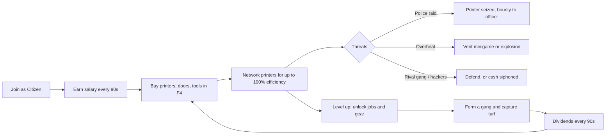
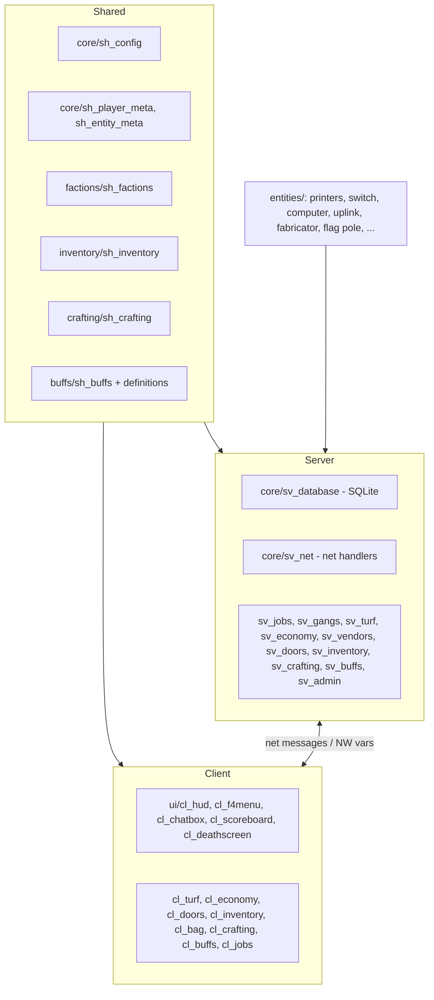
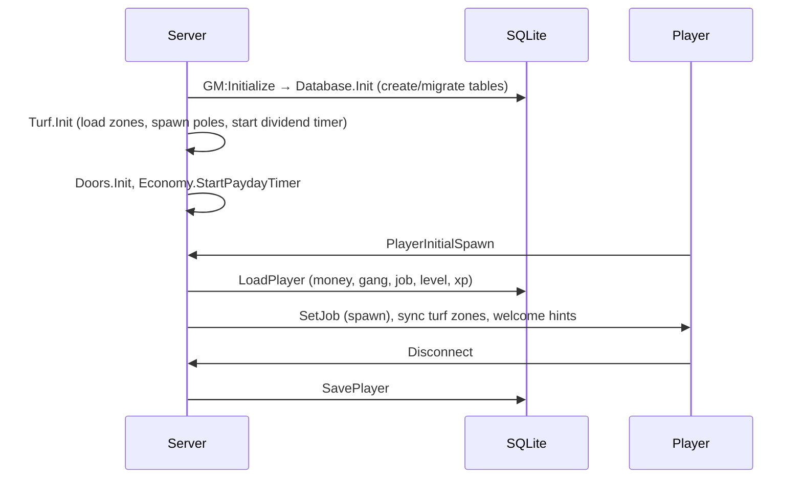
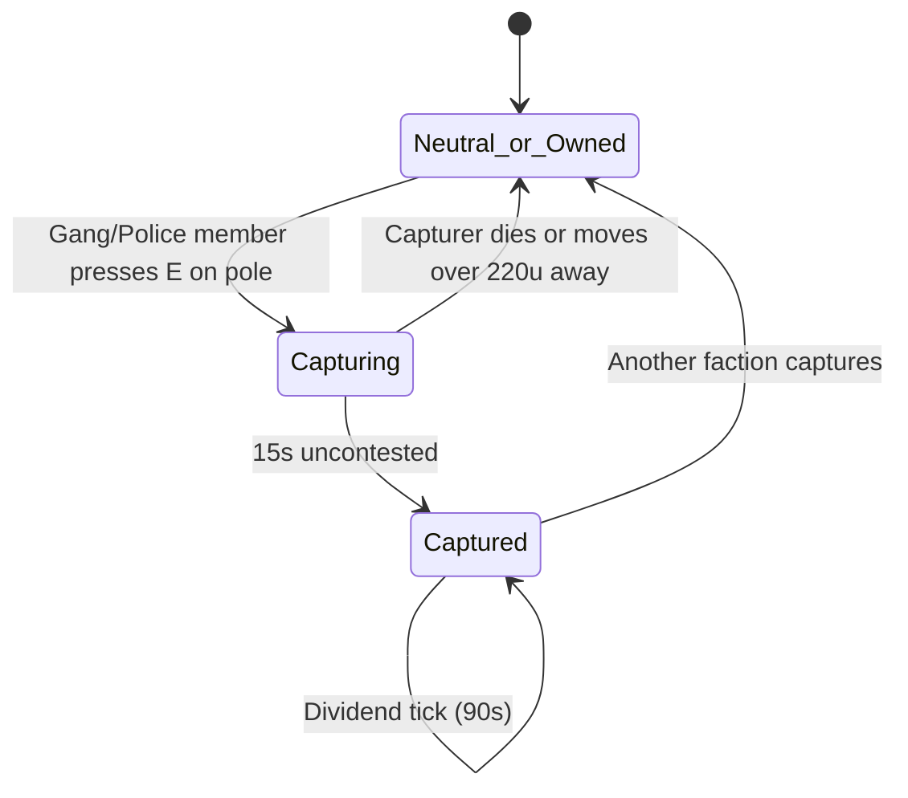

# GangWars RP (GWRP)

**Version:** 2.0.0 (2026) · **Author:** Toxic · **Base gamemode:** `sandbox` · **Maps:** `^rp_*`

GangWars RP is a Garry's Mod roleplay gamemode built around three competing groups: **Citizens** (and specialist service jobs), **Street Gangs** and **Police/SWAT**. Players earn money from salaries, money printers, crafting and territory, then spend it on gear, doors, networking hardware and weapons. Gangs fight over **turf**, police raid **contraband printers**, and Cyber Engineers **hack** networks.

---

## Table of Contents
1. [Features](#features)
2. [Requirements & Installation](#requirements--installation)
3. [Quick Start](#quick-start)
4. [Concept of Operations](#concept-of-operations)
5. [How It Operates (Technical)](#how-it-operates-technical)
6. [Configuration](#configuration)
7. [Commands](#commands)
8. [Jobs Reference](#jobs-reference)
9. [Shop Reference](#shop-reference)
10. [Extending the Gamemode](#extending-the-gamemode)
11. [Project Structure](#project-structure)
12. [Credits & License](#credits--license)

---

## Features

- **17 jobs across 3 factions**, with level gates and per-job slot limits.
- **Player-run gangs** with MariaDB-backed rosters, ranks, invites and private gang chat.
- **Turf warfare**: flag poles with timed captures and periodic dividends, per-map zone profiles and an admin setup tool.
- **Economy**: salary paydays, dropped cash, an F4 shop with job/level restrictions and retail markups, and purchasable doors.
- **Money printers** with a heat model, a venting timing minigame, hardware modules (undervolt / overclock) and police confiscation.
- **Networking gameplay**: L3 switches, copper/fiber cables, WAN uplinks, and efficiency that scales with network topology.
- **Cyber layer**: an in-game computer terminal (nmap, ping, airmon, WAN cracking, Metasploit-style exploits) and the CyberDeck phone.
- **Crafting**: Resource Fabricators produce ingots, carbon rods and weapon blueprints, which are crafted into weapons, bags and gear.
- **Inventory**: a 16-slot backpack plus four equippable bags, with quality tiers.
- **Buff/debuff engine**: persistent, stackable effects (healing, speed, wanted, poison and more).
- **Leveling**: levels 1–50 on an MMO-style XP curve.
- **Persistence**: Production MariaDB (via mysqloo v9) with 100% Stored Procedures for writes, Analytical Views for reads, in-memory RAM caching, range-partitioned telemetry, and automatic SQLite development fallback.
- **Optional Wiremod** outputs on printers, switches and computers.

---

## Requirements & Installation

**Requirements**
- A Garry's Mod dedicated server (or listen server).
- An `rp_` map. A default turf template ships for `rp_downtown_v4c_v2`.
- *Optional:* Wiremod (enables wire outputs and inputs on entities).

**Install**
1. Copy this folder to `garrysmod/gamemodes/gangwarsrp/`. The folder name must match [gangwarsrp.txt](gangwarsrp.txt).
2. Start the server with:
   ```
   +gamemode gangwarsrp +map rp_downtown_v4c_v2
   ```
3. Import the MariaDB schema from `sql/gw_mariadb_schema.sql` into your database (`mysql -u root -p gw < sql/gw_mariadb_schema.sql`).
   Configure database credentials in `garrysmod/data/gw/database.json` or startup ConVars (`+gw_db_host 127.0.0.1 +gw_db_user root +gw_db_password secret +gw_db_database gw`).
   If running locally without the `mysqloo` binary module, the gamemode will automatically fallback to SQLite emulation for development.
4. Grant yourself admin (`admin` or `superadmin` user group) to use setup tools.

> Entities and weapons live in `entities/` inside the gamemode folder and are loaded with the gamemode.

---

## Quick Start

1. Join the server. You spawn as a **Citizen** with **$250**.
2. Press **F4** for the Store & Jobs menu. Press **F2** for the door/property menu.
3. You earn your job's salary every **90 seconds**.
4. Buy a **Money Printer**, plus a **Copper Wiring Tool** and **L3 Network Switch** to network several printers for higher efficiency.
5. Create a gang with `/creategang <name>` ($200), or go police, and capture **flag poles** for dividends.
6. Level up from kills, turf captures and printer collection to unlock better jobs and gear.

---

## Concept of Operations

### Intent
Create a self-sustaining crime-and-order sandbox. Every economic activity creates risk and a counter-play opportunity for another faction.

### Actors

| Actor | Goal | Main tools | Counter-play |
|---|---|---|---|
| **Citizens** (Citizen, Pharmacist, Cyber Engineer, Security Contractor, Arms Dealer, Hobo) | Build bases, run printers, provide services | Printers, doors, clinic pods, networking, crafting | Police may seize printers. Gangs and hackers target them. |
| **Street Gangs** (Gangster, Gang Leader, Thief, Hitman, Black Market Dealer) | Control turf, steal and raid, trade contraband | Turf poles, lockpicks, shipments, stims | Police contest turf. Rival gangs fight. |
| **Police / SWAT** (Officer, Chief, SWAT, Mayor) | Suppress contraband, hold turf, enforce *wanted* status | Contraband scanner, stunstick, battering ram, bounties | Gang resistance. Police capture turf as the shared "Police" claimant. |

### Core gameplay loop



### Risk / reward summary
- **Printers** pay well at high efficiency but heat up. Unvented printers explode and deal blast damage.
- **Networking** boosts printer efficiency (60% → 80% → 100%) but cables snap past a maximum length and exposed networks can be scanned and exploited.
- **Police** are rewarded for confiscating printers (+50% for Patrol Officers) and for seizing territory.
- **Turf** gives gang members passive income and XP, but capturing requires staying within 220 units of the pole for 15 seconds without dying.
- **Death** drops 10% of your cash (capped at $75), and *Wanted* status persists across death and logout.

---

## How It Operates (Technical)

### Architecture



`gamemode/init.lua` registers all client/shared files with `AddCSLuaFile` and includes server modules. `gamemode/shared.lua` derives from `sandbox` and loads the shared modules.

### Boot sequence



On shutdown, every player plus the turf map profile is committed.

### Runtime loops

| Loop | Interval | Effect |
|---|---|---|
| Payday | 90 s | Each player receives their job salary. |
| Turf dividends | 90 s | Online members of an owning gang (or Police) receive $25 per owned turf and 25 XP. |
| Printer cycle | 20 s per printer | Adds `PrintAmount × efficiency` to stored cash and raises temperature. |
| Buff ticks | per buff | HoT, poison and so on, persisted so offline time is handled correctly (`tickOffline`). |

### State and networking
- Player state (money, job, gang, level, XP) is held in **networked vars** (`GW_Money`, `GW_Job`, `GW_Gang`, `GW_Level`, `GW_XP`) and saved to SQLite.
- Client actions (buy, change job, door actions, admin actions) use **net messages** with **per-action rate limiting** (`GW.CheckRateLimit`) and server-side validation (level, job, distance, affordability).
- Admin net actions require `IsAdmin()`/`IsSuperAdmin()`.

### Persistence

[core/sv_database.lua](gamemode/core/sv_database.lua) provides:
- `?`-placeholder **prepared statements** with sanitization, plus a **catalog of named procedures** (`GW.Database.Call("GET_PLAYER", {steamid})`).
- **Nested transactions** (`WithTransaction`) with automatic rollback.
- **Migrations** for added columns.

| Table | Purpose |
|---|---|
| `gw_players` | money, respect, gang, job, level, xp, last_seen |
| `gw_gangs` / `gw_gang_members` | gang registry, bank, leader, member ranks |
| `gw_inventory` / `gw_player_bags` | slot-grid items and equipped bags |
| `gw_turfs` | per-map turf zones and owners |
| `gw_player_buffs` | persistent buffs and debuffs |
| `gw_settings` | key/value settings |

Turf zones are also exported to `data/gangwarsrp/maps/<map>.json` as a backup. Load order is **SQLite → JSON → built-in template**.

### Turf capture flow



A capture pays the capturer **$40 + 150 XP** and announces the result server-wide. Citizens cannot capture. Gang members need a gang first.

### Printer & network efficiency model
- Base yield (per 20 s cycle): **Bronze 4 · Silver 10 · Diamond 25**, multiplied by efficiency.
- Efficiency: **60%** standalone, **80%** with 2 printers on a switch, **100%** with 3 or more. This works out to about **$12 / $30 / $75 per minute** at 100%.
- **Overclock**: +50% yield, +3 heat per cycle. **Undervolt**: heat per cycle 4 → 1. **Cyber-Tuned** (Cyber Engineer with the Cryo Calibrator): +20% yield, −25% heat.
- Temperature of **100 °C** triggers an explosion. Use the vent minigame (press **E**, then **E** again inside the sweet spot) or the Calibrator to cool. A failed vent jams the valve and spikes temperature.
- Switches have 2 copper ports, a combo SFP and an uplink SFP. Cable limits: **550 u** copper, **800 u** fiber. WAN uplinks link networks wirelessly with matching keys.

### Crafting & inventory
- Resource Fabricators roll a weighted table: Zinc 48 · Iron 24 · Steel 12 · Blueprint 10 · Carbon Rod 6.
- Recipes (weapons need a blueprint plus ingots; bags and gear need only ingots) are defined in [sh_crafting.lua](gamemode/crafting/sh_crafting.lua).
- Items stack and go in the first free slot: backpack (16) then equipped bags (Satchel +6, Duffel +10, Rucksack +16).

### Progression
- XP to next level = `floor(250 × level^1.65)`, with a maximum level of **50**.
- XP sources: player kill 50 (+50 for a rival gang kill), turf capture 150, turf hold tick 25, printer collect 20. Salaries give no XP.
- Level-up grants **$500 × new level**.

---

## Configuration

Main settings are in [gamemode/core/sh_config.lua](gamemode/core/sh_config.lua).

| Setting | Default | Meaning |
|---|---|---|
| `StartingMoney` | 250 | New player wallet |
| `PaydayInterval` | 90 | Seconds between salaries |
| `DropMoneyOnDeathMax` | 75 | Max cash dropped on death (10% of wallet) |
| `GangCreationCost` | 200 | `/creategang` fee |
| `TurfCaptureRadius` / `TurfCaptureTime` | 450 / 15 | Capture range (units) and hold time (s) |
| `TurfDividendInterval` / `TurfDividendAmount` | 90 / 25 | Dividend period and per-turf payout |
| `TurfCaptureReward` | 40 | Instant capture bonus |
| `MaxPrintersPerPlayer` | 4 | Printer cap (defined in config; not currently enforced by the gamemode code) |
| `PoliceBountyPerPrinter` | 125 | Default seize bounty |
| `MaxCableLength` / `MaxFiberCableLength` | 550 / 800 | Cable snap distances |
| `WLANSniffMaxDistance` | 2500 | Wireless recon range |
| `PrinterStandaloneEfficiency` / `...Network2` / `...Network3` | 60 / 80 / 100 | Efficiency tiers |
| `DoorCost` | 15 | Door price (70% refund on sale) |
| `Level.*` | see file | Max level, XP curve, rewards |
| `DefaultShopMarkupPercent` | 65 | Default kiosk markup |

Jobs are in [sh_factions.lua](gamemode/factions/sh_factions.lua). Shop items are in `GW.ShopItems` in `sh_config.lua`.

---

## Commands

### Player
| Command | Description |
|---|---|
| `F4` / `F2` | Store & Jobs menu / property menu |
| `/dropmoney <amount>` | Drop cash at your crosshair |

### Gang
| Command | Description |
|---|---|
| `/creategang <name>` | Found a gang ($200, name 2–24 chars) |
| `/invitegang <player>` | Invite a player |
| `/acceptgang` | Accept an invite |
| `/leavegang` | Leave your gang |
| `/disbandgang` | Disband (leader only) |
| `/gang` | Show gang info, bank vault balance, and controlled turfs with tax rates |
| `/gang deposit <amt>` | Deposit personal cash into the gang vault |
| `/gang withdraw <amt>` | Withdraw money from gang vault (Leader only) |
| `/settax <5-30>` | Set territory protection tax rate (Leader only) |
| `/g <msg>` or `/gangchat <msg>` | Private gang chat |

### Admin (admin or superadmin)
| Command | Description |
|---|---|
| `/admin`, `/debug`, `gw_admin` | Open the admin/debug HUD |
| `/turfsetup`, `/adminsetup`, `gw_turfsetup` | Open the turf editor |
| `/setmoney`, `/addmoney <player> <amt>` | Wallet control |
| `/setlevel <player> <lvl>`, `/addxp <player> <amt>` | Progression control |
| `gw_setlevel`, `gw_addxp` | Console equivalents |

The admin HUD also provides: set job/gang/health/armor, godmode, goto/bring/respawn, trigger payday/dividends and spawn entities.

---

## Jobs Reference

| Faction | Job | Lvl | Salary | Slots |
|---|---|---|---|---|
| Citizens | Citizen | 1 | $6 | ∞ |
| | Pharmacist | 1 | $12 | 3 |
| | Cyber Engineer | 3 | $14 | 3 |
| | Security Contractor | 2 | $13 | 4 |
| | Arms Dealer | 2 | $10 | 3 |
| | Hobo | 1 | $0 | 4 |
| Gangs | Gangster | 1 | $10 | 16 |
| | Gang Leader | 5 | $20 | 4 |
| | Thief | 3 | $10 | 4 |
| | Hitman | 6 | $16 | 2 |
| | Black Market Dealer | 4 | $12 | 2 |
| Police | Police Officer | 1 | $16 | 6 |
| | Police Chief | 5 | $25 | 1 |
| | SWAT Specialist | 7 | $22 | 2 |
| | Mayor | 5 | $35 | 1 |

All jobs receive fists, keys, physgun, gravity gun and toolgun. Police also spawn with duty ammo. Officers respawn in 5 s; everyone else in 15 s.

---

## Shop Reference

| Category | Examples |
|---|---|
| Supplies | Universal Ammo, Bandage, First Aid Kit, Kevlar Vest (Arms Dealer) |
| Weapons (shipments) | Glock, Shotgun (Arms Dealer); Deagle, AK-47, Lockpicks (Black Market) |
| Medical | Clinic Pod and Medkit (Pharmacist) |
| Networking | Wiring Tool, Cryo Calibrator, L3 Switch, PC, WAN Uplink, CyberDeck, Undervolt/Overclock modules |
| Printers | Bronze ($250), Silver ($750, L4), Diamond ($2,200, L8), Resource Fabricator ($500, L2, max 2) |
| Debug | `[DEBUG]` buff/debuff items for testing only. Disable or remove on production servers. |

---

## Extending the Gamemode

- **Add a job:** add an entry to `GW.Jobs` in `factions/sh_factions.lua` (name, level, faction, salary, weapons, models, max, desc).
- **Add a shop item:** add to `GW.ShopItems` in `core/sh_config.lua` (`type` = weapon/ammo/entity/shipment/consumable/armor/medkit/buff).
- **Add a crafting recipe or material:** edit `GW.Crafting.Materials`, `DropTable` and `Recipes` in `crafting/sh_crafting.lua`.
- **Add a buff:** call `GW.Buffs.Register(id, {...})` in `buffs/sh_buff_definitions.lua`. Hooks include `OnApplied`, `OnTick`, `OnRemoved`, `ModifySpeed` and `ModifyDamageTaken`.
- **Add an entity or weapon:** create a folder under `entities/entities/` or `entities/weapons/` with `shared.lua`, `init.lua` and `cl_init.lua`. Register item data in `sh_inventory.lua` or `GW.Config.EntityQualities`.
- **Add a DB query:** add a named statement to `GW.Database.Procedures`, then call it via `GW.Database.Call`.

---

## Project Structure

```
gwrp/
├── gangwarsrp.txt            # Gamemode manifest
├── gamemode/
│   ├── init.lua, cl_init.lua, shared.lua
│   ├── core/       config, networking, meta, notifications, database, net, admin
│   ├── factions/   jobs, factions, gang commands
│   ├── turf/       zones, capture engine, setup UI
│   ├── economy/    payday, cash, F4 shop purchases
│   ├── doors/      purchase / sell / sharing
│   ├── inventory/  items, bags, persistence
│   ├── crafting/   materials, recipes, fabricator logic
│   ├── buffs/      buff engine and definitions
│   └── ui/         HUD, F4 menu, chatbox, scoreboard, death screen
└── entities/
    ├── entities/   printers, switch, computer, WAN uplink, modules, fabricator,
    │               flag pole, clinic pod, shipment, cash stack, crafting material
    └── weapons/    GWRP firearms, keys, lockpick, medkit, wire tool, repair tool,
                    scanner, battering ram, CyberDeck phone
```

---

## Credits & License

Created by **Toxic**. License: *not yet specified. Add a `LICENSE` file before distributing.*
